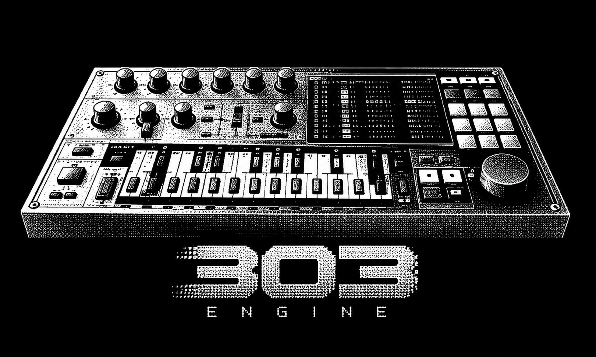
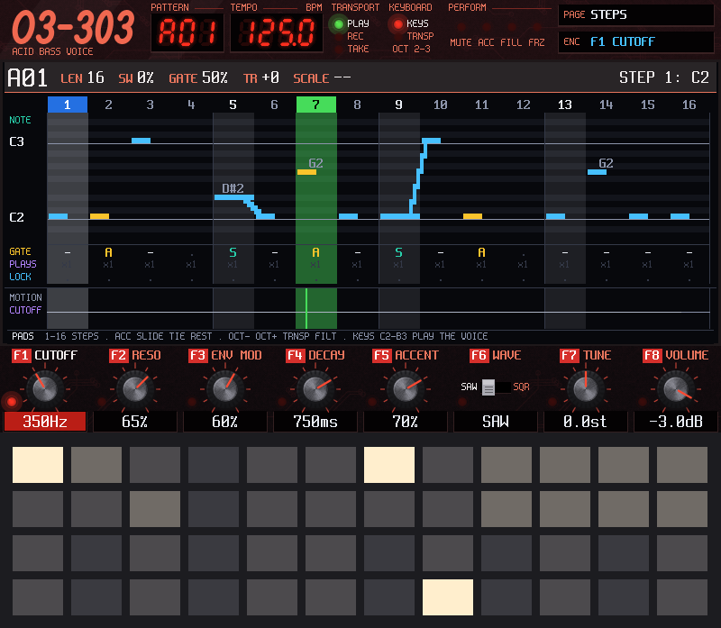
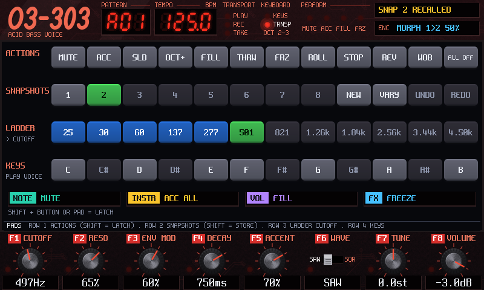
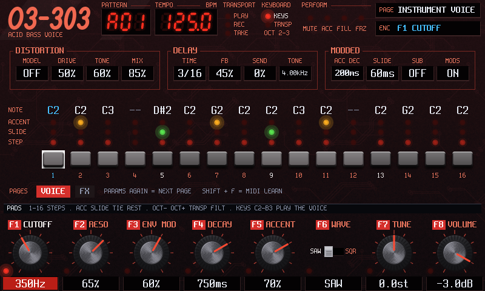
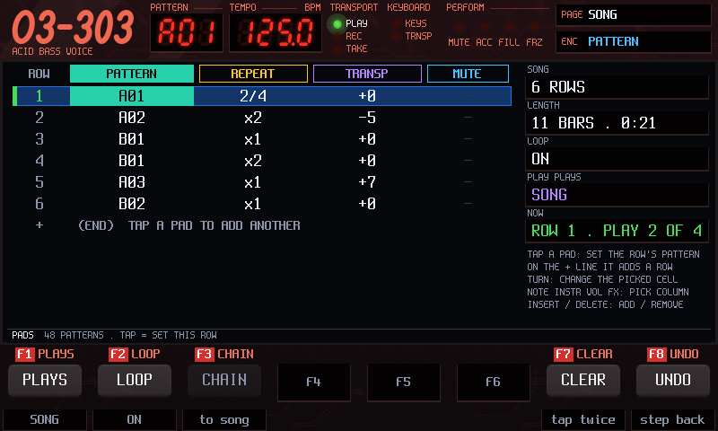
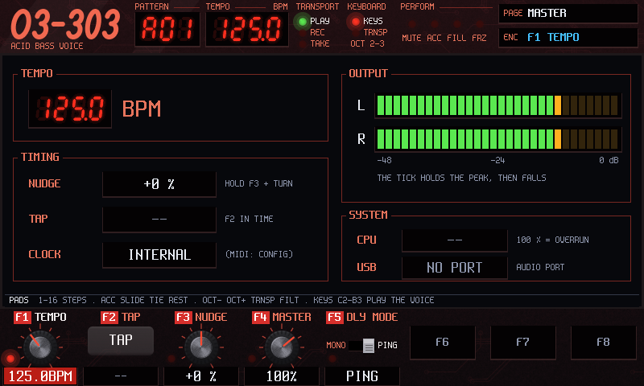

<p align="center">
  
</p>

<h1 align="center">o3-303</h1>

<p align="center"><b>Turn the Tracker into an acid bass machine: a 303-style voice, a step sequencer you play on the 48 pads, and a performance screen.</b></p>

<p align="center">
  <a href="https://github.com/trak3r-os/o3-303/releases"></a>
  <a href="docs/MANUAL.md"></a>
  <a href="docs/CHANGELOG.md"></a>
  <a href="LICENSE"></a>
  <a href="https://github.com/trak3r-os/o3-sdk"></a>
  
  
</p>

<p align="center">
  <a href="https://github.com/trak3r-os/o3-303/releases"><b>Download</b></a> ·
  <a href="docs/MANUAL.md"><b>Manual</b></a> ·
  <a href="docs/MANUAL.md#4-the-first-five-minutes"><b>First five minutes</b></a> ·
  <a href="docs/CHANGELOG.md"><b>What's new</b></a> ·
  <a href="#build"><b>Build it</b></a>
</p>

<p align="center">
  
</p>

> **Unofficial.** o3-303 is not affiliated with or endorsed by Polyend. "Tracker" is used only to describe the hardware it runs on.
> o3-303 is a whole firmware: it replaces the unit's own software while it is installed, so back up your card first.

## What is it?

One instrument: a monophonic bass line in the spirit of the TB-303, with a sequencer built around accent, slide and the filter. You keep
the hardware you know, the pads, the buttons, the encoder and the screen, and they all become the 303.

- **The voice.** Saw or square wave, cutoff, resonance, envelope, accent and eleven Devil Fish-style mods. One switch, MODS, turns the mods
  off to hear the plain 303.
- **Growl and wobble.** A vowel filter and an LFO synced to the tempo, with a five-model distortion and a delay.
- **The sequencer.** 48 patterns of 8, 16, 32 or 64 steps, with accent, slide, tie and rest. A step can ratchet, play only now and then, or
  hold its own value of a knob, and knob moves can be recorded as motion.
- **PERFORM.** The 48 pads become live actions (mute, fills, rolls, freeze, tape stop, wobble), eight sound snapshots with a morph, a pad
  ladder for the filter, and a keyboard.
- **SONG.** Rows of patterns played in order, with repeats and transposes.
- **512 ready-made lines and sounds** in eight banks, to start from.
- **Projects that save themselves** to the card while you play, and RECORD to keep what you play as a WAV.
- **MIDI.** Play it from a keyboard, follow a clock, teach it a controller.

## The screens

<table>
  <tr>
    <td><a href="docs/MANUAL.md#perform"></a></td>
    <td><a href="docs/MANUAL.md#instrument"></a></td>
  </tr>
  <tr>
    <td align="center"><b>PERFORM</b>: the pads as live actions, snapshots and morph</td>
    <td align="center"><b>INSTRUMENT</b>: the sound, with the line in front of you</td>
  </tr>
  <tr>
    <td><a href="docs/MANUAL.md#song"></a></td>
    <td><a href="docs/MANUAL.md#master"></a></td>
  </tr>
  <tr>
    <td align="center"><b>SONG</b>: patterns in order, with repeats</td>
    <td align="center"><b>MASTER</b>: the tempo, the timing and the output meters</td>
  </tr>
</table>

The pictures come from the o3-303 simulator, which draws the same screens as the unit. Click one for that screen in the manual.

## Get it on your Tracker

1. **Download** `o3-303-<version>.ptf` and `SHA256SUMS` from the [releases](https://github.com/trak3r-os/o3-303/releases) page, and check the
   download with `sha256sum -c SHA256SUMS`.
2. **Back up** the whole SD card, and keep the firmware you run now on your computer: that is your way back.
3. **Install** it from the card with the unit's hidden reset button, or over USB from a firmware with the console.
   [Section 2 of the manual](docs/MANUAL.md#2-install-it-and-go-back-to-the-stock-firmware) has every step, and how to go back.

Then read [the first five minutes](docs/MANUAL.md#4-the-first-five-minutes). After that you can stop reading and play.

## Learn it

- [The player's manual](docs/MANUAL.md): everything, with a picture of every screen
- [The panel at a glance](docs/MANUAL.md#3-the-panel-at-a-glance) and [the pads](docs/MANUAL.md#6-the-pads)
- [The screens, one by one](docs/MANUAL.md#5-the-screens-one-by-one)
- [Experiment without fear](docs/MANUAL.md#7-experiment-without-fear): snapshots, undo and how to get back
- [MIDI](docs/MANUAL.md#10-midi), [recording a take](docs/MANUAL.md#11-recording-a-take) and [the two looks](docs/MANUAL.md#13-two-looks-classic-and-obsidian)
- [When something goes wrong](docs/MANUAL.md#14-when-something-goes-wrong)
- [The changelog](docs/CHANGELOG.md): what changes in each release

## Status

o3-303 is a pre-release, and it needs more testing. Each [release](https://github.com/trak3r-os/o3-303/releases)'s notes list what has been
checked and any known problem.

<details>
<summary><b>Milestones and unit sessions</b></summary>

| Milestone | What | State |
|---|---|---|
| M3 | o3-303 on the kit: the voice and distortion ported from Replicant 303 (the voice since rewritten on Open303, `docs/VOICE-303.md`), the delay, the sequencer (8 to 64 steps, accent, slide, tie, swing, gate, motion, p-locks, chains, undo), the GEN vault, the 303 screens | built and verified on the host, image statically gated; its unit check (M3-PLAN item 4) has no page in `docs/hw/` (`docs/M3-PLAN.md`) |
| M3b | The performance round: pad filter ladders, snapshots and morph, momentary FILL, ratchets, trig conditions, beat freeze, tempo nudge, scale-locked keyboard, assignable performance buttons | built 2026-10-25 and 2026-10-26; the beat freeze and the snapshot morph checked on the unit, the rest owed (`docs/M3B-PLAN.md`) |
| M3c | The bass-music round: growl, wobble, rolls, tape stop and reverse (crush, trance gate, pump, dive, riser and OTT are backlog) | built and unit-checked for growl, wobble and rolls (2026-10-26); by-ear checks owed (`docs/M3C-PLAN.md`) |
| UX | The new way the app is used: PERFORM, the HOME map, PATTERN SETUP, INSTRUMENT, MASTER, FILE, RECORD, the Config pages, the project with autosave, HELP | waves 1 to 6 built (2026-10-30 and 2026-10-31), checked on the unit by console only; SONG built and host-verified, unit check owed (`docs/UX-PLAN.md`) |
| SKIN | The obsidian skin, OBSIDIAN by default since SK8: the assets (SK1), the core, header and F row on HOME and SETUP (SK2, SK3), SONG (with SG2) and PERFORM (SK4) committed; INSTRUMENT (SK5), MASTER and RECORD (SK6), MODDED, GROWL and WOBBLE (MODS S3), FILE PROJECTS with its name keyboard and LIBRARY's classic fallback in the obsidian colours (SK7) built and host-verified; OBSIDIAN by default (SK8) built | in v0.5.0; read on the unit by console, the draw peak 5,685 µs against a budget of 6,000 (`docs/hw/2026-11-06-v050.md`); SU2, the rows by eye, owed (`docs/SKIN-PLAN.md`) |
| M4 | The HOOKS screen (sample launcher, synced sampling) | cancelled 2026-11-01: o3-303 is only a 303. The three Sample buttons open MODDED, GROWL and WOBBLE instead (`docs/MODS-PLAN.md`) |
| MODS | The 303 mods on MODDED (eleven controls, and MODS to turn them off), GROWL and WOBBLE on the Sample buttons: slices S0 to S4, the kit's strip area (KS1) | in v0.5.0; read in part on the unit by console (`docs/hw/2026-11-06-v050.md`); the rest of the unit gate, by hand and by ear, owed (`docs/MODS-PLAN.md` section 11) |

### On the Tracker

The unit sessions are in `docs/hw/`.

| Session | Image (commit) | What it showed |
|---|---|---|
| 2026-10-26, M3b-a | `f3c08e6` | The beat freeze: exact loop lengths, no clicks, a 10-minute soak clean; playback as before. Render CPU about 37 % of a block playing, peak 44.4 % |
| 2026-10-26, M3b ui and M3c | `78109ff`, then `2bf2944` | The growl costs +2.4 % of a block after the optimisation (it was +7 %); everything on peaks at 49.9 %, 0 over-budget; a 10-minute soak clean; the snapshot morph clean |
| 2026-10-30, FT812 fill rate | o3-sdk `apps/fillrate` | The display's sprite limit per line (about 216 at cell 100); the input to the skin's design |
| 2026-10-30, U3 | `93382bf` | SETUP and INSTRUMENT on the screen; autosave with 0 underruns; the project back after a reboot |
| 2026-10-30, U5 | `0f95cc5` | Waves 4 and 5: MASTER, FILE, the Shift row's labels, PERFORM SETUP; a 1-bar and a 30 s take written to the card, CPU 33 to 35 % while recording |
| 2026-10-31, U6a | `767f33e` | Wave 6 (C1): the Config pages 303 and DEEP and their values after a reboot; a DEEP value no longer drops the project at boot |
| 2026-11-01, SU1p | `c2e050c` | The skin's console rows: every main screen skinned, boot no slower, render max 49.4 % recording; the skin's draw peak 2.6 to 5.1 ms against its 2 ms budget, with 0 dropped frames. The rows by eye are owed |
| 2026-11-01, MIDI | `c2e050c` | USB MIDI from a computer: notes on pitch, clock follow exact from 60 to 300 BPM, no drift in 10 minutes, clock out within 0.001 %, learn after a restart, a 20-minute soak clean; a cold Start is about 25 ms late (fix MC1) |
| 2026-11-06, B1 to B3 | `9f3e1a2` | Ten backlog items: the ROOT and the key LEDs, FILE LIBRARY's slots, Left and Right with an F key held, MIDI accent at velocity 96 (about 2.3 times louder in a USB capture); render max 50.1 %, 0 underruns |
| 2026-11-06, B4 to B6 | `51dd939` | The ladder rows on HOME, the held repeat, the encoder's curve, a learned CC moving CUTOFF; render max 53.2 %, 0 underruns; the skin's draw over the 2,000 µs budget it had then, so the budget became 6,000 µs |
| 2026-11-06, v0.5.0 | `4df5c20`, `d39ce44`, then the tag `108f63f` | OBSIDIAN by default, INSTRUMENT's new layout, GROWL's and WOBBLE's F8, MODS; the skin's draw peak 5,685 µs; render max 58.5 % on HOME and 64.8 % once across the round, 0 underruns; the tagged image started. One hang after a console `reset`, until a power cycle, cause unknown |

U1 and U2 have no results recorded (their pages say `to fill`); U4 was superseded by U5 before it was installed.

Needs more testing on the unit: the pads, the knobs and the LEDs by hand; the encoder rows, tap tempo, NameEntry, LOAD and REVERT; DIN MIDI and
MIDI learn with a real controller; the SONG screen (a song with repeats by ear); HELP by eye; the growl's vowels and the wobble's rates by
ear; SU1's rows by eye; the MODDED, GROWL and WOBBLE pages and their mods by hand and by ear (MODS-PLAN section 11); and the list under "Not shown on a unit yet" in [CHANGELOG.md](docs/CHANGELOG.md). The card cases of U2 (a card pulled during a save, no card, write-protect, a card swap) were dropped by the
maintainer and are not planned.

USB audio out, saving to the card and MIDI come from o3-sdk's M2b and are used here: the project autosaves to the card, and MIDI notes
play the voice.

</details>

## Build

No unit needed for the first part: the simulator runs the app on a computer, and writes the screens as PNG and the sound as WAV.

The two repositories side by side (o3-sdk next to this directory, `-DO3SDK_DIR=<path>` otherwise):

```sh
git clone https://github.com/trak3r-os/o3-sdk.git
git clone https://github.com/trak3r-os/o3-303.git
cd o3-303
```

The host build needs CMake 3.24 or newer and a C++17 compiler; the image needs the ARM GNU toolchain 15.3.rel1.

```sh
cmake -S . -B build-host
cmake --build build-host -j4
ctest --test-dir build-host --output-on-failure

# the app in the simulator: PNG snapshots of the screen and the pads, and the audio as a WAV
mkdir -p /tmp/o3_303
build-host/app/o3_303_sim --scenario app/scenarios/boot.txt --out /tmp/o3_303

# the firmware image: build-mk66/app/o3_303.ptf
cmake -S . -B build-mk66 -DO3SDK_PLATFORM=mk66 -DARM_GNU_ROOT=<arm-gnu-toolchain-15.3.rel1 dir>
cmake --build build-mk66 -j4
```

## Layout

`app/` the app, its screens and its scenarios · `app/seq/` the sequencer, the pattern operations and the preset generator ·
`units/` its DSP units (`acid_voice`, the voice; `distortion`; `freeze`, the beat freeze and its modes; `growl`) · `tests/` host tests · `third_party/replicant303/` the pinned Replicant 303
sources (MIT) the ports are tested against · `docs/` the design and the plans · `.claude/` the agent harness, from o3-sdk. Start with
[CLAUDE.md](CLAUDE.md).

## Documents

<details>
<summary><b>The design, the plans and the unit sessions</b></summary>

| Document | What it is | Read it when |
|---|---|---|
| [docs/MANUAL.md](docs/MANUAL.md) | The player's manual: install, the panel, the first five minutes, every screen with its picture, projects, settings, MIDI, troubleshooting | to play the instrument |
| [docs/CHANGELOG.md](docs/CHANGELOG.md) | What changes for a player in each release, and what the unit has shown of it | before installing a release |
| [CLAUDE.md](CLAUDE.md) | The rules for agents and contributors: the framework, the hard rules, the build and the tests | before changing anything |
| [docs/DESIGN-303.md](docs/DESIGN-303.md) | The design: the sound, the sequencer's data and the open decisions (section 8); HOOKS (section 7) is cancelled. Its status block says which controls have moved on | for what the app is and why |
| [docs/UX-303.md](docs/UX-303.md) | The specification of the screens, buttons, pads, Config, HELP and the project | before touching a screen, a button or a pad |
| [docs/UX-PLAN.md](docs/UX-PLAN.md) | The slice plan for the UX waves, with each slice's state and the unit checks owed | to see what is built and what the unit still has to show |
| [docs/SKIN-PLAN.md](docs/SKIN-PLAN.md) | The obsidian skin: the look, the budgets, the o3-sdk contracts and slices SK1 to SK8 | before working on the skin |
| [docs/M3-PLAN.md](docs/M3-PLAN.md) | M3, the first playable 303: the voice, the distortion, the sequencer and the vault | for the voice, the distortion and the sequencer's first form |
| [docs/M3B-PLAN.md](docs/M3B-PLAN.md) | M3b, the performance round: ladders, snapshots, FILL, ratchets, the freeze | for the performance features |
| [docs/M3C-PLAN.md](docs/M3C-PLAN.md) | M3c, the bass-music round: growl, wobble, rolls; the cut items as backlog | for the growl, the wobble, the rolls |
| [docs/MODS-PLAN.md](docs/MODS-PLAN.md) | The 303 mods on MODDED, GROWL and WOBBLE on the Sample buttons, HOOKS cancelled: the slices S0 to S4, the unit gate and the decisions | for the mods, the Sample buttons and what the unit still has to show |
| [docs/hw/](docs/hw/) | The unit sessions: one page per session with its image, checklist, results and what was left | before a unit run, and to know what the unit has shown |
| [o3-sdk `docs/FRAMEWORK.md`](https://github.com/trak3r-os/o3-sdk/blob/main/docs/FRAMEWORK.md) | The kit's guide: layers, units, the engine, the controls convention, HELP, the file API and the rules | before writing a unit or a screen |

</details>

## Credits and licence

The voice's filter, envelope law and amplifier are ported from [Open303](https://github.com/RobinSchmidt/Open303) by Robin Schmidt (MIT), with the
numbers it measured on a TB-303. The accent's sweep and the mods follow [Robin Whittle's published Devil Fish notes](https://www.firstpr.com.au/rwi/dfish/).
The oscillator's method, the distortion, the step model and the preset generator are ports of [Replicant 303](https://github.com/DanimanX/Replicant303)
by Daniel Rojas Grasset (MIT). [THIRD_PARTY.md](THIRD_PARTY.md) has the full list.

o3-303 is GPL-3.0-or-later ([LICENSE](LICENSE)).
