# o3-303 player's manual

o3-303 turns the Tracker into an acid bass machine: a 303-style voice with drive, delay, growl and wobble, a step sequencer you play with
the 48 pads, and a performance screen. This manual starts with what makes sound fastest and goes deeper as it goes on. You can stop
reading after section 4 and play.

The pictures come from the o3-303 simulator, which draws the same screens as the unit. Where a picture also shows the pads, the
grid under the screen is the simulator's drawing of the pad lights.

## Contents

1. [What o3-303 is](#1-what-o3-303-is)
2. [Install it, and go back to the stock firmware](#2-install-it-and-go-back-to-the-stock-firmware)
3. [The panel at a glance](#3-the-panel-at-a-glance)
4. [The first five minutes](#4-the-first-five-minutes)
5. [The screens, one by one](#5-the-screens-one-by-one): [HOME](#home), [PATTERN SETUP](#pattern-setup), [PERFORM](#perform),
   [PERFORM KNOBS](#perform-knobs), [PERFORM SETUP](#perform-setup), [INSTRUMENT](#instrument), [MODDED](#modded), [GROWL](#growl), [WOBBLE](#wobble), [MASTER](#master),
   [SONG](#song), [FILE PROJECTS](#file-projects), [FILE LIBRARY](#file-library), [RECORD](#record)
6. [The pads](#6-the-pads)
7. [Experiment without fear](#7-experiment-without-fear)
8. [Projects and the card](#8-projects-and-the-card)
9. [Settings](#9-settings)
10. [MIDI](#10-midi)
11. [Recording a take](#11-recording-a-take)
12. [HELP on the unit](#12-help-on-the-unit)
13. [Two looks: CLASSIC and OBSIDIAN](#13-two-looks-classic-and-obsidian)
14. [When something goes wrong](#14-when-something-goes-wrong)
15. [The USB console](#15-the-usb-console)

---

## 1. What o3-303 is

o3-303 is a whole firmware for the Tracker hardware. It replaces the Tracker's own software while it is installed (section 2 says how to
go back). It is one instrument: a monophonic bass line in the spirit of the TB-303, with a sequencer built around accent, slide and the
filter.


*HOME while the first line plays. The green column is the step playing; the pads under the screen light up with it.*

What is in it:

- **The voice**: saw or square wave, cutoff, resonance, envelope depth and decay, accent, tuning and level. As it starts, it is built to
  sound like a Roland TB-303: dry, with no distortion and no delay. Thirteen more controls, the Devil Fish-style mods on the MODDED pages,
  change the voice's circuit: one switch (MODS) turns all of them off, to hear the plain 303.
  Then a distortion with five models, a delay, a growl (a vowel filter) and a wobble (an LFO you sync to the tempo).
- **The sequencer**: 48 patterns of 8, 16, 32 or 64 steps. Each step has a note, accent, slide, tie or rest, can play up to four times
  (ratchets) or only now and then (conditions), and can hold its own value of a knob (a lock). Knob moves can be recorded as motion.
- **SONG**: rows of patterns played in order, with repeats and transposes.
- **PERFORM**: the 48 pads become live actions (mute, fills, rolls, freeze, tape stop, wobble), eight sound snapshots with a morph, a pad
  ladder for the filter, and a keyboard.
- **FILE LIBRARY**: 512 ready-made lines and sounds in eight banks.
- **RECORD**: records what you play to a WAV file on the card.
- **Projects** that save themselves to the card while you play.

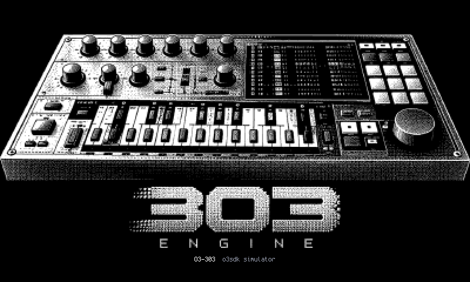

*The first thing you see when the unit starts. The line at the bottom names the build (here, the simulator).*

> **Work in progress.** o3-303 is young, and it needs more testing. Each release's notes list what has been checked and any known
> problem.

---

## 2. Install it, and go back to the stock firmware

o3-303 comes as one file, the image the Tracker's bootloader takes from the SD card. Download it from the project's
[releases](https://github.com/trak3r-os/o3-303/releases): `o3-303-<version>.ptf`, with `SHA256SUMS` next to it. Check the download
before you use it: `sha256sum -c SHA256SUMS`. Each release's notes say what the unit has shown of that version and what it has not, and
[CHANGELOG.md](CHANGELOG.md) lists what changed. A release image has passed the project's release check. If you build the image
yourself (README, "Build"), it is `build-mk66/app/o3_303.ptf`, and it has passed that check only if you ran it.

o3-303 writes only in two places on the card: its own folder `Apps/o3_303/` and the card's `Samples/` folder. Your Tracker projects stay
as they are.

### Install by the card

1. **Back up the whole card** on a computer.
2. **Keep your way back**: the image the unit runs now (the official `PolyendTracker_<version>.ptf`, or another firmware you use) stays
   safe on your computer.
3. On the card, move every `.ptf` file out of the `Firmware/` folder (for example into a new folder `Firmware-old/`).
4. Copy the image (`o3-303-<version>.ptf`, or `o3_303.ptf` if you built it) into `Firmware/` and rename the copy `PolyendTracker_0.0.1.ptf`. It must be the only `.ptf` in `Firmware/`: the
   reset button flashes the first `.ptf` in the card's directory order, which need not be the alphabetical order a computer shows, so with two
   files you cannot tell which one it takes. (The reset button has been seen flashing only files whose names start with
   `PolyendTracker`, at most 24 characters.)
5. Put the card back and press the Tracker's hidden reset button (the maker's emergency-flashing instructions say where it is). The
   bootloader writes the image and the unit starts o3-303.

### Go back to the stock firmware

1. Move every `.ptf` out of `Firmware/`.
2. Put the official `PolyendTracker_<version>.ptf` alone in `Firmware/`.
3. Press the hidden reset button.

The bootloader is separate from the firmware, and an image that does not start does not remove it: the card and the reset button are
the way back. That way back is documented for the stock firmware and track3r-os. Going back from an o3-sdk image this way was still a
check to run on a unit on 2026-10-25 (o3-sdk's check M2-15), so keep the card backup and the old image at hand.

### Install over USB

If the unit already runs a firmware with the USB console (track3r-os v1.0.0, or another o3-sdk image such as o3-303 itself), a computer
can put o3-303 on the card and start it, and go back the same way, with no hands on the unit. This is for the people who build the image.
The step by step is in o3-sdk's guide,
[section 11, "Install over USB, and the way back"](https://github.com/trak3r-os/o3-sdk/blob/main/docs/NEW-APP.md#11-install-over-usb-and-the-way-back),
and the tools are described in
[platform/mk66/tools/README.md](https://github.com/trak3r-os/o3-sdk/blob/main/platform/mk66/tools/README.md).

---

## 3. The panel at a glance

o3-303 uses every button of the Tracker. This manual calls them by the names HELP shows on the unit.

| Button | What it does in o3-303 |
|---|---|
| **Pattern** | HOME, the step screen, from any screen. On HOME a tap opens PATTERN SETUP, and held, the 48 pads are the 48 patterns |
| **Params** | INSTRUMENT, on VOICE and FX. Again: the other page |
| **Performance** | PERFORM. Again: PERFORM KNOBS, and back. **Shift + Performance**: PERFORM SETUP, from any screen; Performance leaves it |
| **Song** | SONG |
| **Master** | MASTER (tempo and level). Hold it and turn: nudge the tempo. **Shift + Master**: tap tempo, from any screen |
| **File** | FILE PROJECTS. Again: FILE LIBRARY. **Shift + File**: save the project, from any screen |
| **Sample Rec** | RECORD |
| **Sample Load** | MODDED: NOTES, then TONE (again). **Shift + Sample Load**: MODS, the mods heard or off, from any screen |
| **Sample Play** | GROWL |
| **Sample Edit** | WOBBLE |
| **Config** | The unit's settings. **Shift + Config**: HELP for the screen you are on |
| **Play** | Play and stop. **Shift + Play**: restart from step 1 |
| **Rec** | Write mode on HOME (the keys write notes); on PERFORM, records knob and ladder moves. **Shift + Rec**: arm or stop an audio take, from any screen |
| **Note, Instr, Vol, Fx** | The four colour buttons. HOME: they give the encoder one row of the step (NOTE, GATE, PLAYS, LOCK). PERFORM: four live actions. SONG: they pick a column |
| **Copy, Insert, Delete** | Step editing on HOME (copy, make a tie, clear; Shift + Insert pushes the steps right) |
| **Arrows** | The cursor; Up and Down change the note. With an F key held, Left and Right move that knob by a twentieth of its range |
| **F1 to F8** | The eight keys under the screen. Their names are always on the screen, just above them |
| **Encoder** | Turns what the ENC window names. With Shift held it moves in bigger steps. Config's ENCODER (page DISPLAY: OFF, NORMAL, FAST) makes a fast spin move a knob, a step's lock and the FILE and LIBRARY lists further; a switch, a short list, Shift's coarse steps and the morph stay one value a detent |
| **Shift** | Hold it for the second meaning of a button (HELP shows them in blue). With Shift held, the F keys show their Shift row |

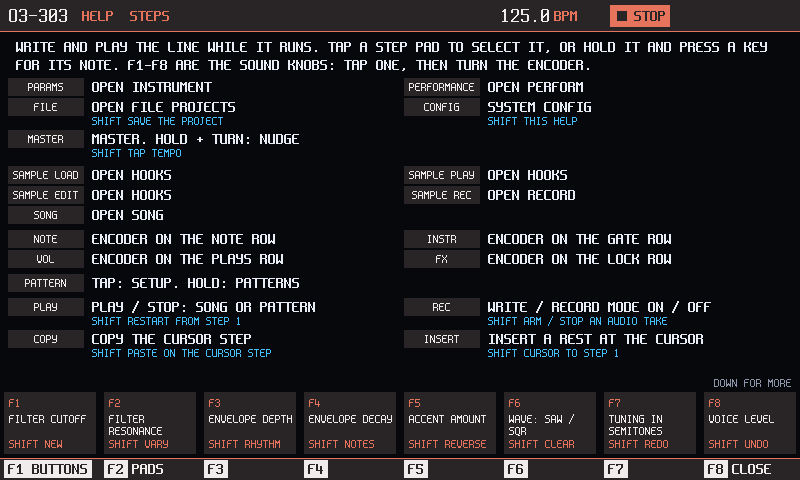

*HELP's BUTTONS page (Shift + Config) on HOME. Every screen has one; section 12 explains HELP.*

### Reading the screen

With the OBSIDIAN look (section 13), the top of the screen is a 303-style panel header:

- **PATTERN** and **TEMPO**: the pattern shown and the tempo in BPM, in red digits.
- **TRANSPORT**: PLAY (green while it plays; it reads SONG while Play plays the song), REC (write mode), TAKE (an audio take is armed
  or recording).
- **KEYBOARD**: KEYS (the keys play the voice) or TRNSP (the keys transpose the line), and the two octaves the keys play (OCT 2-3).
- **PERFORM**: four lights for the live actions (at first, the colour buttons' MUTE, ACC, FILL and FRZ); a lit one is on.
- **PAGE**: the screen's name, or a short message for a moment ("SAVED", "NEW LINE").
- **ENC**: what the encoder turns now ("F1 CUTOFF"). With Shift held on HOME and PATTERN SETUP it also gives the value ("CUTOFF 456 Hz"), because the Shift row hides the knobs.

Under the screen's main area, the **PADS** line says in one sentence what the four rows of pads do on this screen. At the bottom, the
**F row** names F1 to F8 and shows their values.

The CLASSIC look shows the same things in plain bars: the screen's name, the tempo and PLAY or STOP at the top, then a line with ENC and
KEYS or TRNSP.

---

## 4. The first five minutes

The pictures in this section show the OBSIDIAN look, the one the unit starts in. CLASSIC (section 13) shows the same messages in its
status line.

Switch the unit on. After the boot screen you are on HOME, with a factory line in pattern A01 (with a card in, the project you used last
comes back instead). Pads are counted here by **row** (1 is the top row) and **column** (1 is the left).

### Play it and shape it

Press **Play**. The line plays. Turn the **encoder**: F1 CUTOFF is picked when the unit starts, so the filter opens and closes. Tap
**F2** (RESO) or any other F key and turn again: the encoder now moves that knob. **Play** again stops.

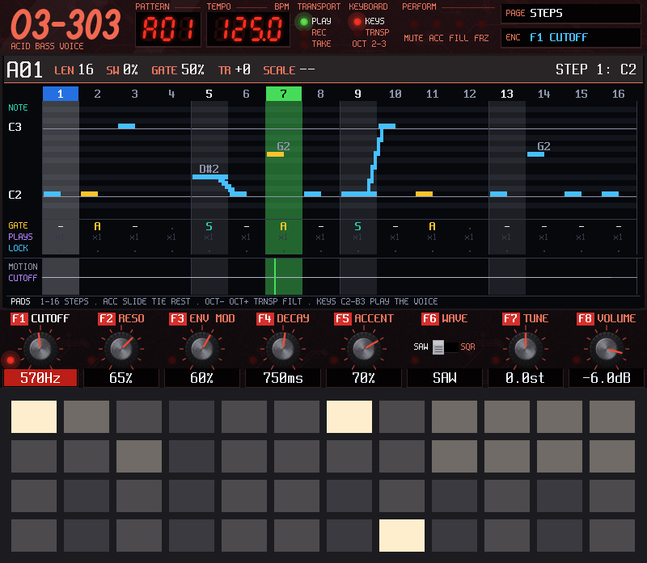

*The encoder moved F1 CUTOFF from 350 Hz to 570 Hz while the line played. The lit F key is the one the encoder turns.*

### Pick an empty pattern

Hold **Pattern**: the pads become the 48 patterns, A01 to D12 (row 1 is A, row 2 is B, and so on). Tap the first pad of row 2, **B01**,
and let Pattern go.

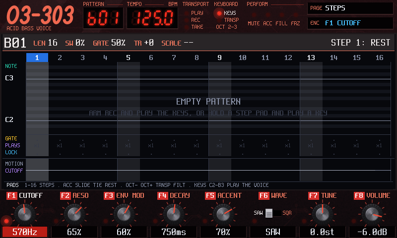

*B01 is empty. The screen tells you what to do next.*

### Write notes

Press **Rec** (REC lights in the header). Now each key you play writes its note on the cursor step and moves to the next step. The keys
are rows 3 and 4: row 4 is C2 to B2 from the left, row 3 is C3 to B3. The pad at **row 1, column 12** is **REST**: it writes a silent
step. Play sixteen notes or rests, then press **Rec** again to leave write mode.

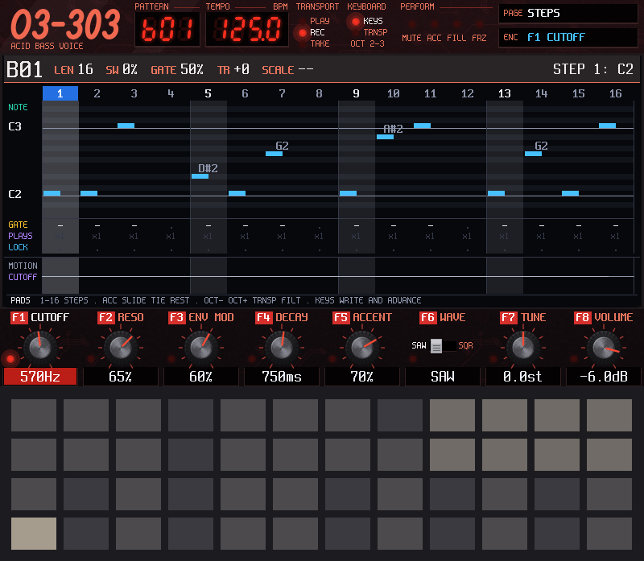

*Sixteen steps written with REC on. The dots in the GATE row are rests. The PADS line says what the keys do now.*

With REC on and the line playing, hold a key and the note lasts as long as you hold it: the steps it covers become ties. A key played just
before a step lands on it (past half of a step, a key goes on the next one; the note that sounds now is the key's own). The whole held note
is one UNDO step. Played with the line stopped, the keys write and move on as above.

### Add accents and slides

Hold a **step pad** and tap **ACC** (row 1, column 9) or **SLIDE** (row 1, column 10). Steps 1 to 8 are row 1, columns 1 to 8; steps 9
to 16 are row 2, columns 1 to 8. An accented step shows **A** in the GATE row and plays louder and brighter; a slide shows **S** and glides
into the next note.

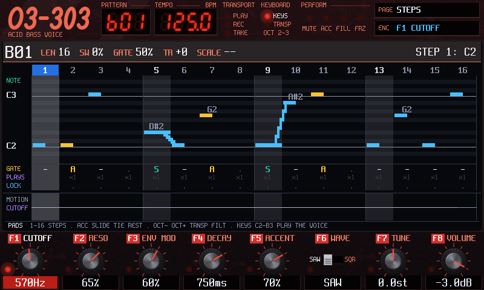

*Accents are amber; a slide draws its glide to the next note.*

Press **Play** and listen to your line.

### Save it

Press **Shift + File**. The PAGE window says SAVING, then SAVED. You did not have to: with a card in, o3-303 saves your work by itself
about ten seconds after you stop changing things (section 8). Shift + File makes a save you can come back to with REVERT.

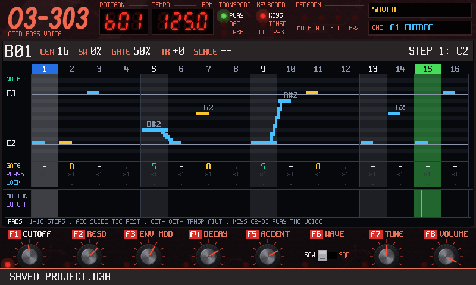

*After Shift + File: SAVED in the PAGE window.*

That is the core of it. The rest of this manual is the detail.

---

## 5. The screens, one by one

Every screen keeps the same rules: the F row is labelled, the PADS line says what the pads do, Shift + Config opens HELP, and Pattern
brings you back to HOME. The pictures show the OBSIDIAN look where a screen has it; CLASSIC shows the same things in plainer boxes
(section 13).

### HOME

HOME is where you write and play the line. The PAGE window says **STEPS**. The middle of the screen shows 16 steps: the notes as bars on a
piano roll (the NOTE row is the roll itself), and under it three rows that hold what else each step does: GATE, PLAYS and LOCK.

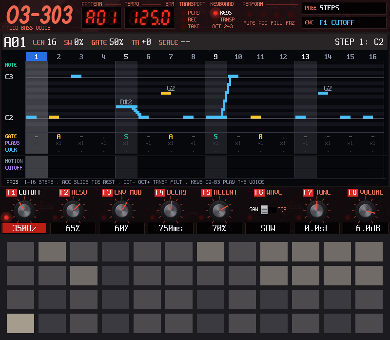

*HOME, stopped. Step 1 is the cursor (blue number). Under the screen, the pads show the steps, ACC and SLIDE, and the keys.*

**The F row** is the voice: F1 CUTOFF, F2 RESO, F3 ENV MOD, F4 DECAY, F5 ACCENT, F6 WAVE (saw or square), F7 TUNE, F8 VOLUME. Tap an F key,
then turn the encoder. Hold an F key and turn to change that knob without moving the encoder off the one you picked.

**The pads** (section 6 has the full map):

| Pads | What they do |
|---|---|
| Steps 1 to 16 (rows 1 and 2, columns 1 to 8) | Tap: put the cursor on that step. Stopped, hold: hear the step. Hold + a key: that step's note. Hold + turn: a lock (below) |
| ACC, SLIDE (row 1, columns 9 and 10) | Tap: accent or slide on the cursor step, on or off. Held + a step pad: that step's accent or slide, on or off, like a drum machine |
| TIE, REST (row 1, columns 11 and 12) | Tap: tie or rest on the cursor step. With REC on they are written like a note. Held + a step pad: that step's tie or rest |
| OCT-, OCT+ (row 2, columns 9 and 10) | The keys' octave down or up (three octaves either way) |
| TRNSP (row 2, column 11) | On: while the line plays, a key transposes it (the C at the bottom left is no transpose). Off: the keys play the voice |
| FILT (row 2, column 12) | On: rows 3 and 4 become the filter ladders (below) |
| Keys (rows 3 and 4) | Play the voice. With REC on: stopped, write and move on; playing, write at the step playing |

With REC on, hold ACC or SLIDE while you play a key and the note is written with an accent or a slide.

**The buttons on HOME:**

| Button | Alone | With Shift |
|---|---|---|
| Left, Right | Cursor left, right (across the pages of a long pattern) | Turn the whole line one step left or right |
| Up, Down | The cursor step's note a semitone up or down. On a rest or a tie the first press makes it a note without moving the pitch (a tie keeps the pitch it carried, a rest takes the last note before it, else the keyboard's C); later presses move it | An octave |
| Copy | Copy the cursor step | Paste on the cursor step |
| Insert | A note or a rest becomes a tie, a tie becomes a rest (every step pad you hold takes it) | Insert a rest at the cursor and push the rest right |
| Delete | Clear the step | Remove the step and pull the rest left |
| ACC or SLIDE held + Left, Right | Move only the accents or slides one step | |
| An F key held + Left, Right | That knob a twentieth of its range per press (one value for a switch, a list or a knob of under 20 steps); a press records like a turn. Keep Left or Right held and it repeats, each repeat recorded the same way; on a held step the repeats are one undo. With no F key held a held arrow moves the cursor once | |

#### The step rows and the colour buttons

The four colour buttons give the encoder one row of the cursor step (or of every step pad you hold):

| Button | Row | What the encoder walks through |
|---|---|---|
| Note | NOTE | The note, a semitone a detent (Shift: an octave), C1 to C5 |
| Instr | GATE | REST (.), NOTE (-), ACC (A), SLD (S), ACC+SLD (AS), TIE (~) |
| Vol | PLAYS | x1 x2 x3 x4 (the step plays that many times), 75% 50% 25% (a chance), 1:2 2:2 1:4 2:4 3:4 4:4 (only on pass 1 of every 2, and so on), FILL and NOT FILL, shown !FILL (only while FILL is on, or only while it is off), FIRST and NOT FIRST, shown !FIRST (FIRST plays only on the first pass; NOT FIRST on every pass except the first) |
| Fx | LOCK | The step's own value of the last knob you picked (CUTOFF at first); turned below its lowest, the lock goes ("--") |

The encoder stays on the row until you tap an F key, which gives it back to the knob, or you leave the screen: a row never outlives its screen, and the ENC window is the only place that says who owns the encoder. There is no timeout.

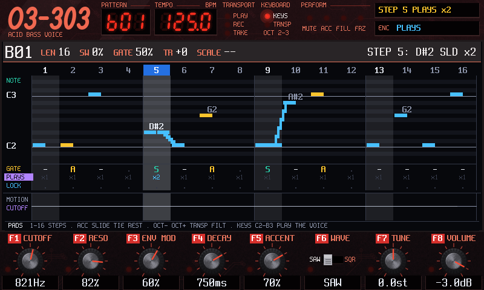

*Vol, then one detent: step 5 now plays twice. The ENC window says PLAYS.*

#### Locks and motion

- **A lock** is a step's own value of a knob. Hold a step pad and turn the encoder: the knob picked on the F row gets a value for that step
  only. The LOCK row shows it. A pattern holds locks and motion for up to eight knobs; a ninth says "8 LANES USED" (PATTERN SETUP's
  Shift + F4 clears them).
- **Motion**: with REC on and the line playing, turn a knob and the moves are recorded under the playhead. The MOTION lane under the step
  rows shows them.

#### The Shift row: pattern tools

Hold **Shift** on HOME and the F keys become tools for the whole pattern. Each one is one UNDO step.

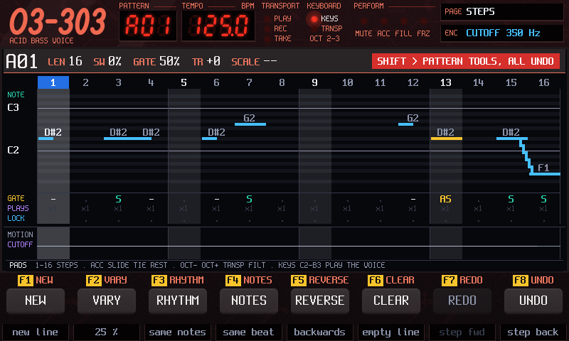

*Shift held on HOME: the pattern tools. REDO is grey because there is nothing to redo.*

| Shift + | Does |
|---|---|
| F1 NEW | A new line from the generator (its settings are on PATTERN SETUP) |
| F2 VARY | Changes about a quarter of the line |
| F3 RHYTHM | New rests, accents and slides; the notes stay |
| F4 NOTES | New notes in the scale; the rhythm stays |
| F5 REVERSE | The line backwards |
| F6 CLEAR | Empties the pattern |
| F7 REDO | Steps forward again |
| F8 UNDO | Steps back |

#### Pattern held: the 48 patterns

Hold **Pattern** and the pads are the 48 patterns (the PAGE window says PATTERNS). Tap one to go to it. While the line plays, the tap
queues it: it starts when the pattern playing ends. More taps while you hold Pattern chain patterns behind it (up to 16), and the chain
plays in order. With two or more patterns queued the chain starts again after its last one and loops until a single tap, with Pattern
held, replaces it; one queued pattern plays and repeats.

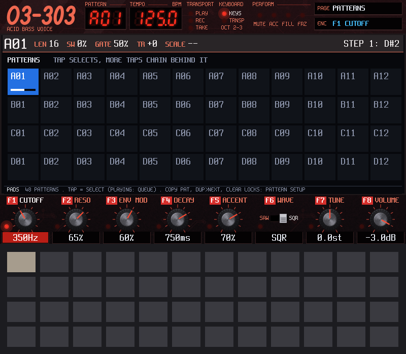

*Pattern held. The grid on the screen matches the pads: row 1 is A01 to A12.*

#### FILT: the filter ladders

Tap **FILT** (row 2, column 12). Rows 3 and 4 become two ladders of 12 places: row 3 is CUTOFF, row 4 is RESO, the left pad the lowest and
the right pad the highest (CUTOFF's pads run from 200 to 2394 Hz on RANGE 303, the range the voice answers to, and over the whole
25 to 4500 Hz on RANGE FISH). A tap glides there in 30 ms (Config's LADDER SLEW). With REC on while the line plays, the jumps are recorded as
motion. Tap FILT again for the keys.

Each ladder row can hold another knob. Hold an F key (on any screen that shares the home map) and tap a pad of the row: the row now holds that
key's knob, and the tap only assigns, the value does not move. Do it again with the same knob held and the row goes back to its default.
**Shift + FILT** puts both rows back to CUTOFF and RESO. The rows blink while an F key is held. The PADS line names both rows. The rows are
saved in the project (an older project loads with the defaults); snapshots do not take them. On PERFORM's skinned look a row that follows the latched key is captioned "> DECAY": the ">" marks it. With REC on, PERFORM's row 3 claims a lane of the pattern, as the F row does, so the limit of eight lanes applies to it. PERFORM KNOBS has the same two rows as its rows 3 and 4.

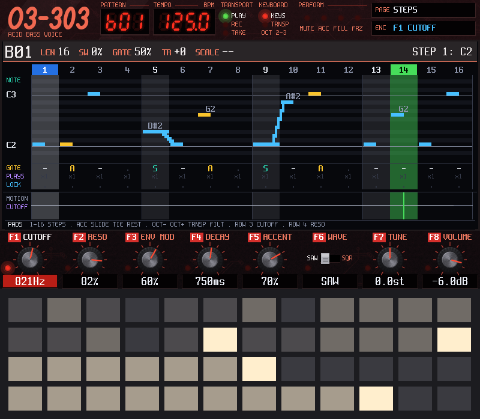

*FILT on. The lit bars on rows 3 and 4 show where CUTOFF and RESO stand.*

#### Long patterns

A pattern of 32 or 64 steps has pages of 16. The step pads show the page the cursor is on; while the line plays they follow the step
playing. A tap on a step pad, or Left or Right to another page, while it plays holds the pads on that page (the title says PAGE n
HELD) so you can work on it; Stop, or a change of pattern, gives the follow back.

### PATTERN SETUP

Tap **Pattern** on HOME. The F row now holds this pattern's settings and the generator's.

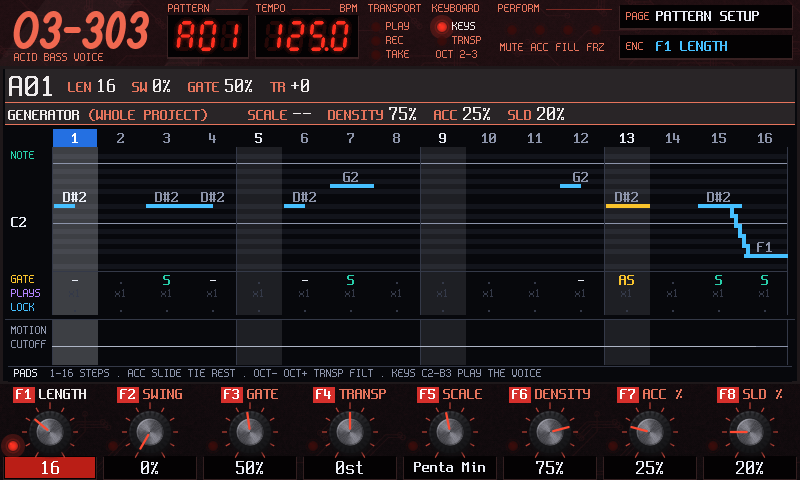

*PATTERN SETUP. F1 to F4 are this pattern's; F5 to F8 belong to the whole project.*

| Key | What | Values |
|---|---|---|
| F1 LENGTH | Steps in this pattern | 8, 16, 32, 64 |
| F2 SWING | Swing | 0 to 66 % |
| F3 GATE | How long the notes are | 5 to 100 % (50 % at first) |
| F4 TRANSP | This pattern's transpose | -24 to +24 semitones |
| F5 SCALE | The scale. Once you choose one, the keys keep to it: the other keys go dark | No scale, Chromatic, Minor, Major, the modes, blues, pentatonics and more (Penta Min at first) |
| F6 DENSITY | How many steps NEW fills | 0 to 100 % (75 %) |
| F7 ACC % | How many accents NEW draws | 0 to 100 % (25 %) |
| F8 SLD % | How many slides NEW draws | 0 to 100 % (20 %) |

The info line says SCALE "--" until you turn F5: until then the keys play every note (NEW still uses the scale shown on F5). With a scale on, the scale's value shows its root ("D MAJOR"), and the keys of HOME light the scale at mid and the root at full; the other keys stay dark.

**The Shift row** on PATTERN SETUP: F1 COPY PAT (copy this pattern), F2 PASTE (paste over this one), F3 DUP>NEXT (copy it into the next
pattern and go there), F4 CLR LOCK (clear every lock and motion of this pattern), F5 ROOT (the encoder sets the generator's root, C to B, until you press an F key; F5 alone gives it back to SCALE), F7 REDO, F8 UNDO.

The steps, the pads and the buttons work as on HOME. Tap **Pattern** to go back.

### PERFORM

Press **Performance**. There is no menu here: the 48 pads are live, and the line keeps playing.

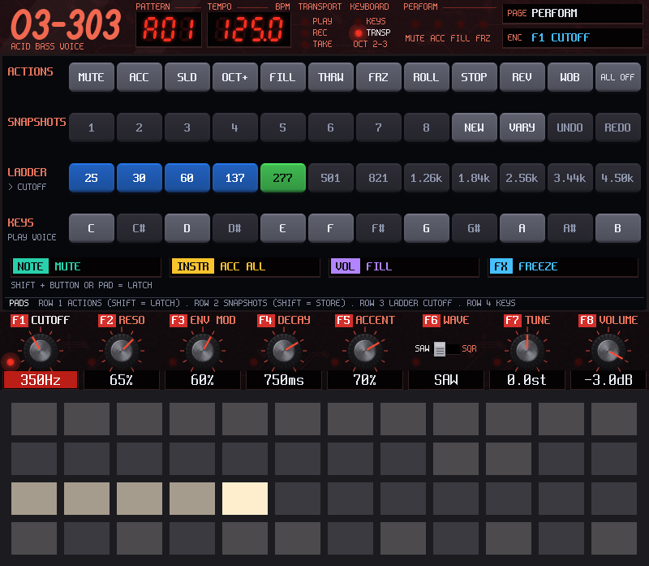

*PERFORM. Each lamp on the screen is the pad under it. Row 3 shows CUTOFF's ladder, its value in green.*

| Row | Pads |
|---|---|
| 1, actions | MUTE, ACC (every note accented), SLD (every step slides), OCT+ (an octave up), FILL (the fill variant), THRW (the delay send opens all the way), FRZ (freeze the beat), ROLL, STOP (tape stop), REV (reverse), WOB (wobble). Column 12 is ALL OFF |
| 2, snapshots and variations | Snapshots 1 to 8, then NEW, VARY, UNDO, REDO (the pattern tools of HOME) |
| 3, ladder | 12 places of the latched knob (the last F key held), or of a knob of its own: hold an F key and tap a pad to assign it, again to follow the latched knob once more. The caption reads CUTOFF, or LATCHED: DECAY. Saved in the project |
| 4, keys | One octave, C to B. They play the voice, or transpose the line while it plays if TRNSP is on (set on HOME) |

**Actions** are on while you hold the pad. **Shift + pad** latches an action: it stays on (a ring around its lamp) until you tap it again
or tap ALL OFF. A latched action stays on when you leave the screen. FRZ, ROLL, STOP and REV share one effect: the first one on wins until
it goes off.

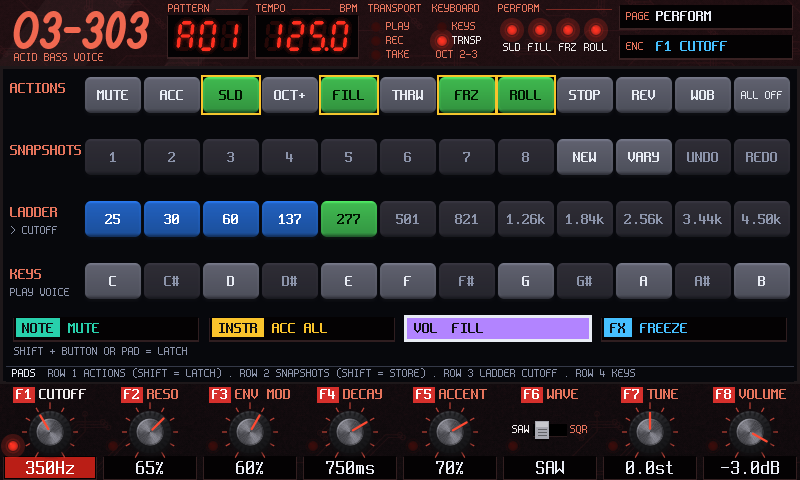

*Four actions latched. The header's PERFORM lights show what is on.*

**The colour buttons** are four more actions, held or latched with Shift. At first: Note is MUTE, Instr is ACC ALL, Vol is FILL, Fx is
FREEZE. PERFORM SETUP changes them.

**Snapshots** keep the sound (the voice, the distortion, the delay, the growl, the level and the delay send). **Shift + a snapshot pad**
stores the sound as it is. A tap recalls it, and then the encoder morphs between the snapshot you came from and the one you recalled (the
ENC window says MORPH 1>2 50%). The first recall morphs from the sound as it was: recalling snapshot 2 first reads MORPH LIVE>2 100%.
An empty slot says so and does nothing. Snapshots are saved with the project.

A new project (first start, NEW and RESET PROJECT) starts with all eight filled, so the pads play at once: **1** the sound as it is, **2** CLOSED DUB (a dark, short saw with a quarter-note delay),
**3** SCREAMER (high resonance, a big envelope and a little tube), **4** HOLLOW (the square wave), **5** OVERDRIVEN (the voice's overdrive and the grit up), **6** LONG (long decays), **7** FISH (RANGE FISH with
the Devil Fish mods on) and **8** GROWL (the growl on). Shift + a pad replaces any of them. A project you saved before keeps its own snapshots, empty ones included.

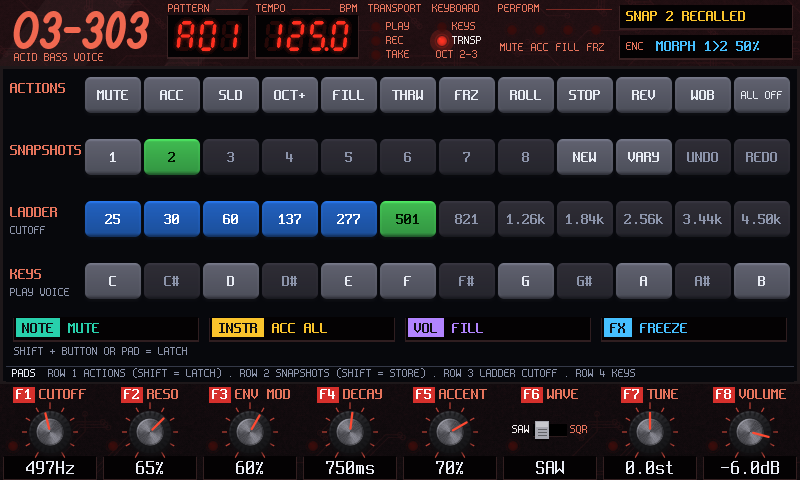

*Snapshot 2 recalled, the encoder halfway back towards snapshot 1.*

**WOB on**: while the wobble runs, row 3 picks its rate: 1/1, 1/2, 1/4, 1/4T, 1/8, 1/8T, 1/16, 1/16T, 1/32, 1/8D, 1/16D.

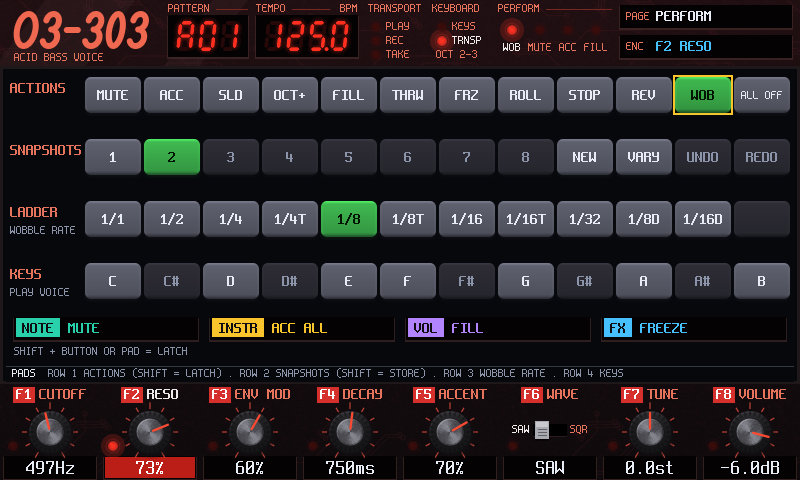

*WOB latched: row 3 is now the wobble's rate.*

**Rec** on PERFORM records the knob and ladder moves while the line plays. **Shift** shows F7 REDO and F8 UNDO.

Press **Performance** again for PERFORM KNOBS (and again to come back). **Shift + Performance** opens PERFORM SETUP.

### PERFORM KNOBS

PERFORM's second page turns the four rows of pads into four knobs. One pad is one value, left the lowest and right the highest, and a tap glides there as on HOME's FILT (Config's LADDER SLEW). The title says PERFORM KNOBS.

| Row | Knob at first |
|---|---|
| 1 | ENV MOD |
| 2 | DECAY |
| 3 | CUTOFF (HOME's FILT row 3) |
| 4 | RESO (HOME's FILT row 4) |

A knob that is a list or a switch, the wave for one, has a pad for each value instead of twelve steps. A tap on a row that holds a MODDED mod while MODS is off (STOCK) switches MODS on, as the encoder does.

**Give a row another knob.** Hold an F key and tap a pad of the row: the row now holds that key's knob, and the tap only assigns, the value does not move. Do it again with the same knob held and the row goes back to its own default. **Shift + F1 to F4** points the encoder at ROW 1 to ROW 4 (the ENC window says ROW 2 LIST): a turn walks the list of every knob that can be recorded (the sound page's, then the delay and distortion, MODDED's NOTES and TONE, and GROWL's), and the toast names it. Tap a pad to use it. **Shift + F8** puts the four rows back to ENV MOD, DECAY, CUTOFF and RESO. The rows are saved in the project (an older project loads with the defaults for rows 1 and 2); snapshots do not take them.

**Rec** records the taps while the line plays. Each knob a row holds takes a lane of the pattern the first time it is tapped with REC on, so the limit of eight lanes applies: a ninth knob says "8 LANES USED: CLEAR LOCKS (SETUP)" and its tap still sounds. Rows 3 and 4 write the lanes HOME's FILT does.

The colour buttons are PERFORM's four actions here too, and the F row is the sound page: it shows the knobs and an F key latches one for the encoder. HELP (Shift + Config) shows the page's pad map.

### PERFORM SETUP

Press **Shift + Performance**, from PERFORM, PERFORM KNOBS or any other screen. Row 1 stays on screen as a reminder, and the F row sets what PERFORM does.

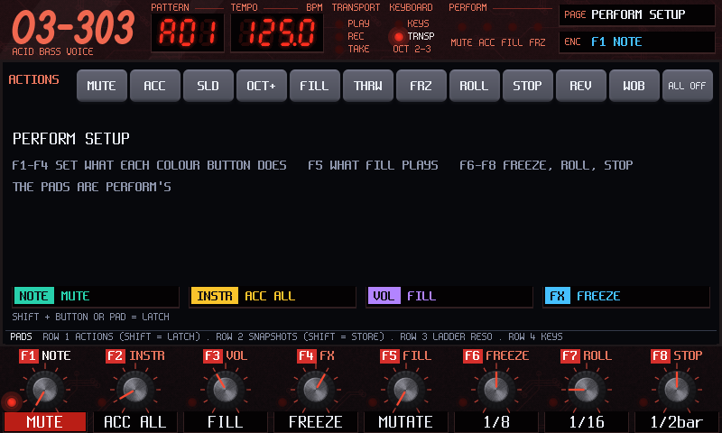

*PERFORM SETUP. The pads still play PERFORM's actions here.*

| Key | What | Values |
|---|---|---|
| F1 NOTE, F2 INSTR, F3 VOL, F4 FX | The action of each colour button | MUTE, ACC ALL, SLD ALL, OCT UP, FILL, THROW, FREEZE, WOBBLE, ROLL, STOP, REV |
| F5 FILL | What FILL plays | MUTATE, OCT UP, RATCHET, ACC ROT |
| F6 FREEZE | The length FREEZE loops | 1/4, 1/8, 1/16 |
| F7 ROLL | The roll's rate, or a build that starts at 1/8 and speeds up every beat or bar | 1/8, 1/16, 1/32, 1/64, BLD BEAT, BLD BAR |
| F8 STOP | How long the tape stop takes | 1/8, 1/4, 1/2, 1, 2 bars |

Press **Performance** to leave: it goes back to the page SETUP was opened from (PERFORM when you came from another screen).

### INSTRUMENT

Press **Params**. INSTRUMENT shows the whole sound on two pages, VOICE and FX: press **Params** again to go to the other one. Tap an F key,
then turn. The other sections of the sound stay in view, and the 16 steps of the pattern sit under them with their accent and slide lights.

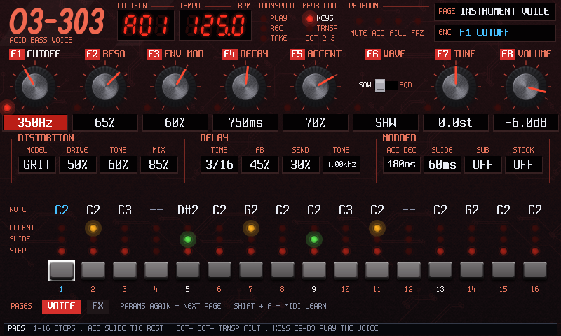

*VOICE: CUTOFF, RESO, ENV MOD, DECAY, ACCENT, WAVE, TUNE, VOLUME. Under them, read-outs of the distortion, the delay and the MODDED
mods (ACC DEC, SLIDE, SUB, MODS).*

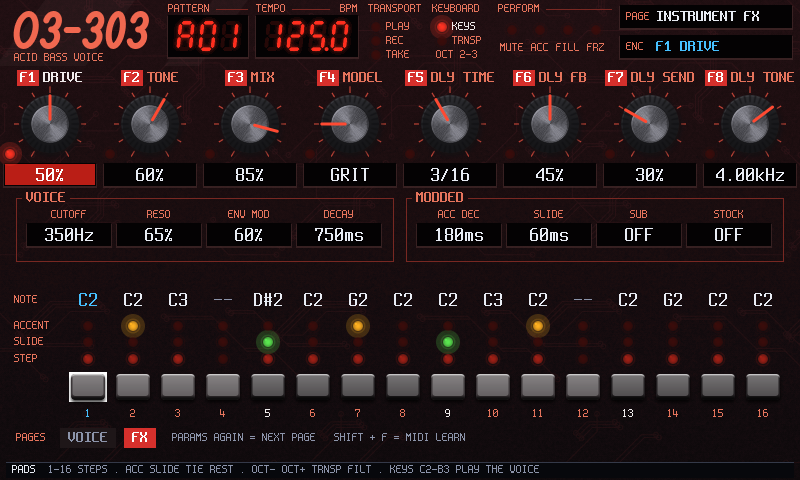

*FX: the distortion on F1 to F4 (MODEL is OFF, GRIT, TUBE, HARD, FUZZ or FOLD) and the delay on F5 to F8.*

**MIDI learn**: hold **Shift** and the F keys say LEARN where a knob can follow a MIDI controller. Press Shift + that F key, then move a
knob on your controller: it is bound. Shift + the same key again cancels. With REC on and the line playing, moving a bound controller is recorded on the current step as turning that knob is; with REC off it only moves the sound. A knob without a lane records nothing. See section 10.

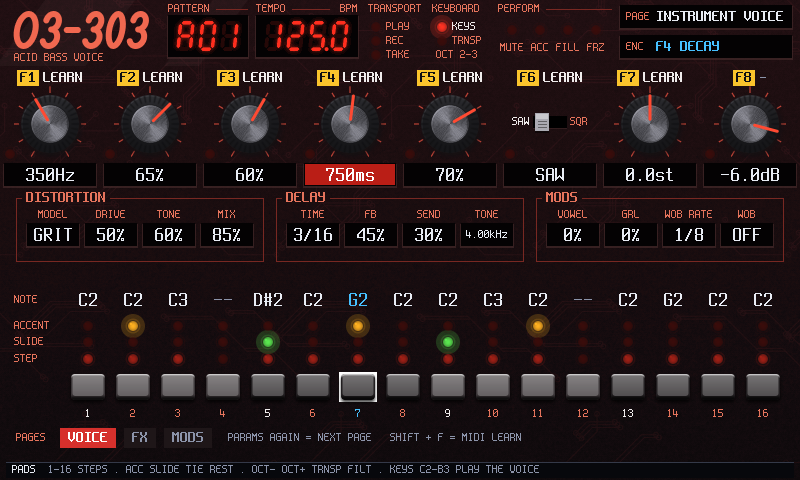

*Shift held on INSTRUMENT: the LEARN row. A dash means that knob cannot be learnt.*

The pads, the steps, Rec and the edit buttons work here as on HOME, so you can keep writing while you shape the sound.

### MODDED

Press **Sample Load**. MODDED opens on NOTES, the page for how a note moves. Press **Sample Load** again for TONE, the page for what
the filter is fed and gives, and again to go back. F8 on either page is **MODS**, the same switch as **Shift + Sample Load** from any
screen (below).

These are Devil Fish-style mods: changes to the 303's circuit of the kind the Devil Fish made popular, with the ranges Robin Whittle published
for it. At their stock values the voice is a plain TB-303, so a MODDED page changes nothing you hear until you turn a knob.

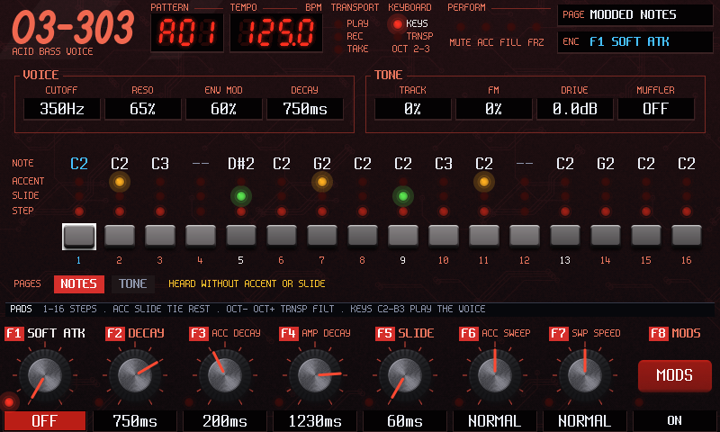

*NOTES. F2 DECAY is the 303's own knob, placed beside ACC DECAY; turning it does not end STOCK.*

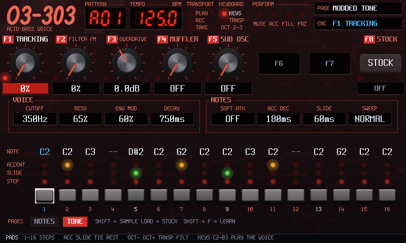

*TONE: what the filter is fed and gives.*

**What each mod does.** The name is the one on the screen. The range and the stock value are the ones in this build. Some starting
values are to be tuned by ear at the unit check (the sub-oscillator's levels, the filter FM depth, the muffler's thresholds, the sweep
speeds' time constants, the height of the accent's sweep); the ranges and the stock values are not.

| Mod | Where | What you hear | Range | Stock |
|---|---|---|---|---|
| SOFT ATK | NOTES F1 | Non-accented notes fade in over the time. OFF is the plain 303's quick attack. Accents and slides keep it | OFF, 0.3, 1, 3, 10, 30 ms | OFF |
| ACC DECAY | NOTES F3 | How long the filter's envelope lasts on an accented note. Normal notes keep DECAY | 30 to 3000 ms | 87 ms |
| AMP DECAY | NOTES F4 | How fast a held note loses its level. Short values give plucks | 16 to 4000 ms | 1430 ms |
| SLIDE | NOTES F5 | The time a slide takes to reach the note | 60 to 360 ms | 60 ms |
| ACC SWEEP | NOTES F6 | OFF: accents do not sweep the filter. NORMAL: the plain 303. HI RES: the sweep with doubled feedback, and the filter can whistle by itself at mid and high cutoffs | OFF, NORMAL, HI RES | NORMAL |
| SWP SPEED | NOTES F7 | How a run of accents builds the sweep. FAST: the first accent is the strongest and the next ones smaller. NORMAL: the plain 303, where RESO decides: low, each accent is a quick pulse; high, the sweep rises late and each close accent climbs higher. SLOW: it rises later, up to twice as high, and takes longer to settle | FAST, NORMAL, SLOW | NORMAL |
| TRACKING | TONE F1 | The filter follows the notes: 100 % is one octave of cutoff for each octave of note, over 100 % opens high notes more. C2 is unchanged at any setting | 0 to 150 % | 0 % |
| FILTER FM | TONE F2 | The output's own sound frequency-modulates the filter: a gritty, unstable edge at higher amounts | 0 to 100 % | 0 % |
| OVERDRIVE | TONE F3 | The level of the oscillator into the filter: more drive, more of the filter's own saturation. It is not the FX distortion, and the two stack. The bottom of the range reads OFF: no oscillator at all, so the voice is nearly silent and HI RES can whistle alone | -24 to +36 dB | 0.0 dB |
| MUFFLER | TONE F4 | A clipping stage after the amp. SOFT rounds the loudest peaks; HARD clips the top and lets the bass through | OFF, SOFT, HARD | OFF |
| SUB OSC | TONE F5 | A square an octave below the note, under the main wave. LOW, MID and HIGH set its level. The one mod that is not the Devil Fish's: it comes from the TD-3-MO | OFF, LOW, MID, HIGH | OFF |
| RANGE | TONE F6 | 303: the plain instrument. FISH: ENV MOD goes from no sweep at all to three times the 303's top, the bass is fuller (32 Hz down about 1 dB, not much more), and a note starts at once and ends at the gate | 303, FISH | 303 |
| SUSTAIN | TONE F7 | The level a held note decays to, for notes that never fade. It ends at the gate | 0 to 100 % | 0 % |

#### MODS

MODS is the A/B switch, lit while the mods are heard. Off, it sets the thirteen mods to their stock values, so you hear the plain 303, and on again, to what you had.

- **On and off:** F8 MODS on either MODDED page, or **Shift + Sample Load** from any screen, with no change of screen. The status line
  says MODS ON or MODS OFF, and MODS OFF: F8 while they are off. While they are off, the header shows a STOCK chip (CLASSIC) or the words STOCK . MODS OFF (OBSIDIAN). A project saved with MODS off opens with them off.
- **Your settings are kept.** MODS changes what you hear, not the values. Turning it off brings each mod back as it was.
- **What ends the plain 303:** a turn of the encoder on one of the mods (MODS goes on first, and the status line says MODS ON, so the change
  is heard), and a LOAD, NEW, REVERT or RESET PROJECT, or the load at start-up, when the project was saved with MODS on (see below).
- **What does not end it:** a MIDI controller, a lane of a pattern, a lock or a snapshot recall. They write the stored value, and you hear
  it when MODS goes on. DECAY, the 303's own knobs, the FX, the growl and the wobble are not touched by MODS.
- **MODS is saved in the project**, with the mods' values: a load, NEW, REVERT or the load at start-up brings it back as it was saved. A project saved
  before this (no MODS state in it), NEW and RESET PROJECT have it on.

### GROWL

Press **Sample Play**. GROWL is one page: the growl's seven knobs, in the order the sound passes through them (the vowel filter, the
comb, then the mix), and F8 switches the growl on and off.

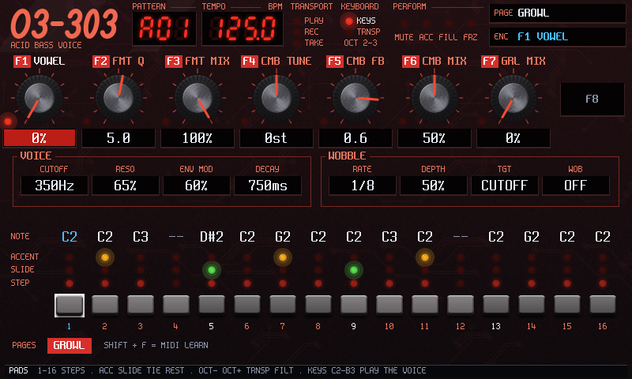

*GROWL, with the VOICE read-outs and the WOBBLE settings under them.*

| Key | What | Range | At first |
|---|---|---|---|
| F1 VOWEL | Which vowel the formant filter sounds: 0 % is "a", 100 % is "u", and between them it passes "e", "i" and "o" | 0 to 100 % | 0 % |
| F2 FMT Q | The formant filter's resonance | 1 to 20 | 5.0 |
| F3 FMT MIX | How much of the vowel filter is heard | 0 to 100 % | 100 % |
| F4 CMB TUNE | The comb's tuning | -24 to +24 semitones | +7 |
| F5 CMB FB | The comb's feedback | -0.95 to +0.95 | 0.6 |
| F6 CMB MIX | How much of the comb is heard | 0 to 100 % | 50 % |
| F7 GRL MIX | The growl's wet and dry, for the whole growl | 0 to 100 % | 0 % (off) |
| F8 GROWL | Mix to 0 (off), and back to the last value, 50 % at first (saved with the project). The strip says GROWL OFF: F8 while off | OFF, ON | OFF |

Shift + an F key is MIDI learn for F1 to F7 (section 10). The pads are the home map, so the line plays and edits while you shape the growl.
Like the other knobs, a growl knob can be locked per step and recorded as motion.

### WOBBLE

Press **Sample Edit**. WOBBLE is one page: the wobble's five settings, F8 WOB, and two empty boxes. The wobble runs while PERFORM's WOB
action is on. F8 latches that action here, the same as WOB on PERFORM, and ALL OFF on PERFORM lets it go.

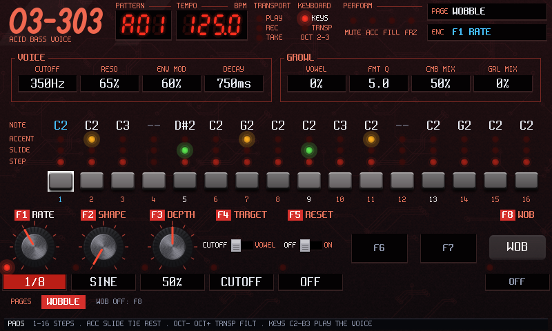

*WOBBLE, with the VOICE and GROWL read-outs under it.*

| Key | What | Values | At first |
|---|---|---|---|
| F1 RATE | The wobble's rate, in beats of the tempo | 1/1, 1/2, 1/4, 1/4T, 1/8, 1/8T, 1/16, 1/16T, 1/32, 1/8D, 1/16D | 1/8 |
| F2 SHAPE | The wave | SINE, TRI, SAW DN, SAW UP, SQUARE, S&H | SINE |
| F3 DEPTH | How far the wobble swings | 0 to 100 % | 50 % |
| F4 TARGET | What the wobble moves: the cutoff, or the growl's vowel | CUTOFF, VOWEL | CUTOFF |
| F5 RESET | Whether each note restarts the wave | OFF, ON | OFF |
| F8 WOB | Runs the wobble, as PERFORM's WOB action does | OFF, ON | OFF |

The wobble's settings are not learnable with MIDI: their Shift row says "-". F8 WOB is not a MIDI control either.

The wobble's five settings and its latch are saved in the project and in each snapshot (the shape and target switch at a recall, they do not glide); an older project or snapshot loads with the defaults. The VOWEL target needs GRL MIX above 0: while the growl is off the encoder says GROWL IS OFF. The strip says WOB OFF: F8 while the latch is off.

### MASTER

Tap **Master**. The encoder starts on the tempo.

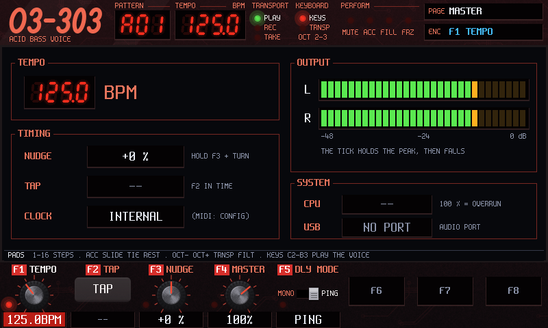

*MASTER while the line plays. CLOCK says where the tempo comes from (MIDI is set in Config). CPU is the sound engine's load on the unit
(the pictures are made on a computer, so it reads "--"); USB says whether a computer is taking the unit's audio.*

| Key | What |
|---|---|
| F1 TEMPO | The tempo, 20 to 300 BPM (125 at first). Shift + turn: bigger steps |
| F2 TAP | Tap it 2 to 4 times in time |
| F3 NUDGE | Hold it and turn: the tempo moves 1 % a detent, at most 3 % either way; let go and it comes back |
| F4 MASTER | The output level |
| F5 DLY MODE | The delay's stereo spread: MONO, or PING (ping-pong, the echoes bounce between the sides). It was on the DEEP page |

From any screen, **hold Master and turn** to nudge, and **Shift + Master** taps the tempo. The pads and the edit buttons work as on HOME.

While a MIDI clock leads the tempo (Config's MIDI section, section 10), TAP and NUDGE do nothing and say "MIDI CLOCK LEADS": the tempo
is the other machine's.

### SONG

Press **Song**. A song is a list of rows, each a pattern played a number of times, maybe transposed, maybe muted.

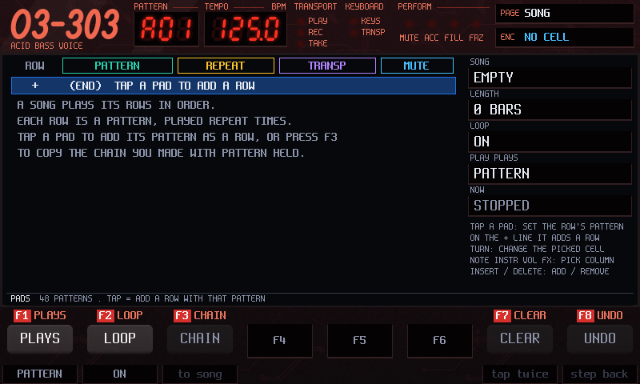

*An empty song. Tap pads to add rows, or press F3 to turn the chain you made with Pattern held into a song.*

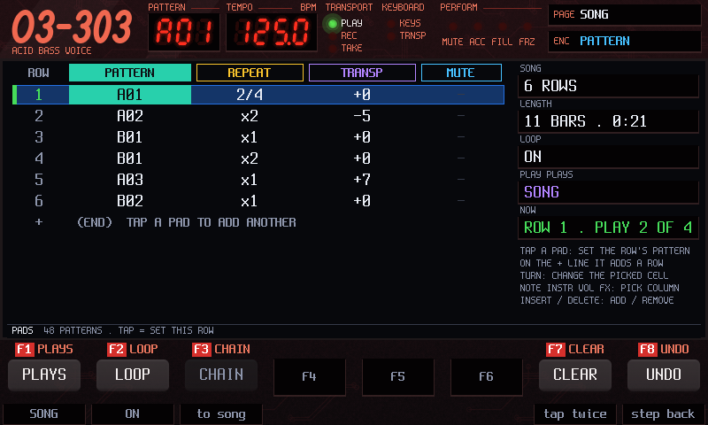

*A song playing. Row 1 is on its second play of four; the panel on the right says where it is.*

- **The pads** are the 48 patterns. On a row, a tap sets that row's pattern. On the **+** line at the end, a tap adds a row. So: go to
  the + line and tap pads in order to build a song.
- **The colour buttons** pick the column the encoder changes: Note PATTERN, Instr REPEAT (x1 to x16), Vol TRANSP (-12 to +12), Fx MUTE (a
  muted row is skipped).
- **Up, Down**: the row. **Left, Right**: a page up or down. **Insert**: add a row above, a copy of this one. **Delete**: remove the row.

| Key | What |
|---|---|
| F1 PLAYS | What Play plays: SONG (from the cursor row) or PATTERN |
| F2 LOOP | ON: the song starts again at the end. OFF: it plays once and stops |
| F3 CHAIN | The chain made with Pattern held becomes the song |
| F4 CLEAR | Empties the song (press twice) |

UNDO and REDO are on Shift here too: **Shift + F8** steps back and **Shift + F7** steps forward, as on HOME. A plain F8 does nothing but say so ("UNDO IS SHIFT + F8"; it was UNDO before, and the message stays for one release).

The song shares the undo history with the patterns, and it is saved with the project.

### FILE PROJECTS

Press **File**. The list shows the projects on the card. The current one is marked with a star, and the line at the top says when it was
last saved.

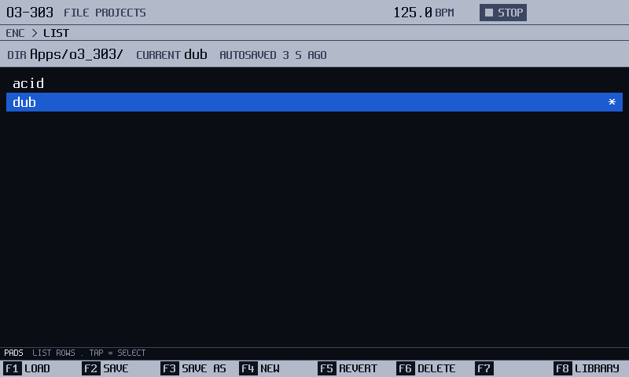

*Two projects on the card; dub is the one open (the star).*

Pick a project with the encoder, Up and Down, or a pad (the first pads are the visible rows, top to bottom), then:

| Key | What |
|---|---|
| F1 LOAD | Open the selected project |
| F2 SAVE | Save now (the same as Shift + File) |
| F3 SAVE AS | Save under a new name |
| F4 NEW | A new, empty project under a new name |
| F5 REVERT | Back to your last save (press twice within 5 seconds) |
| F6 DELETE | Hide the selected project from the list (press twice within 5 seconds). Never the current one |
| F8 LIBRARY | FILE LIBRARY |

LOAD and NEW stop the transport, and the project you are leaving is written to the card first if it has changes.

DELETE removes no file: it puts a small marker file, `.deleted`, in the project's folder, and the list no longer shows that folder. The
files stay on the card, so DELETE does not make room on a full card (section 8, "On the card").

**Typing a name**: SAVE AS and NEW open a keyboard. The pads are the keyboard, row for row (row 2 is Q to P, row 3 is A to L, row 4 is Z
to M and the space). The encoder or the arrows move the orange focus, F1 types the key in focus, Delete erases, F7 accepts and F8
cancels. A name has at most 15 characters.

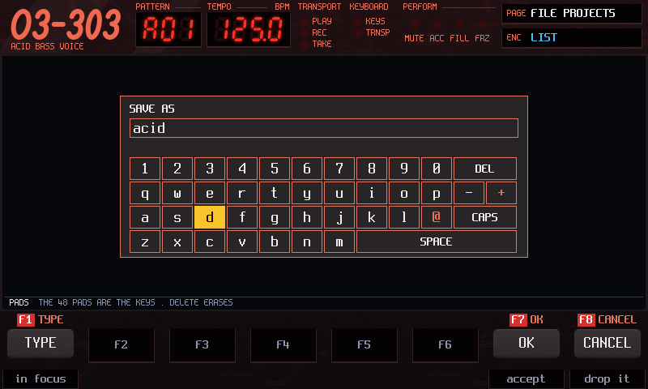

*The name keyboard. "acid" was typed on the pads.*

### FILE LIBRARY

Press **File** twice. The library holds 512 generated lines with their sounds, in eight banks of 64: AMBER, SUB, NEON, ACID, BLADE, ROOFTOP,
OFF WORLD and LAST.

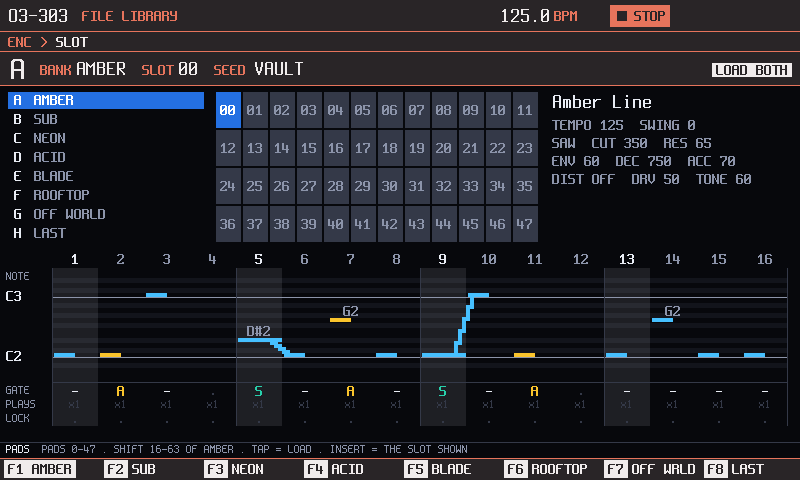

*Bank AMBER, slot 00. On the right, the slot's sound; at the bottom, its line.*

- **F1 to F8** pick the bank.
- **A pad** loads that slot (0 to 47), and **Shift + a pad** loads slot pad + 16 (16 to 63), so every slot of the bank is on a pad (while Shift is held the
  LEDs show slots 16 to 63, the slot shown lit; the PADS line says "PADS 0-47 . SHIFT 16-63"). Either loads into the pattern shown, at once. The screen starts on LOAD LINE: the line and its tempo come in and
  your sound stays; set **Shift + F2** to LOAD BOTH to take the library's sound too (the voice and the distortion). While the transport runs a
  load keeps the tempo and the swing you have and the toast says "TEMPO KEPT"; stopped, the line sets them. UNDO takes back the line only, not
  the tempo or the sound.
- The encoder and the arrows (Left and Right one slot, Up and Down a row of twelve, as on the pads) also pick a slot; **Insert** loads the slot shown. **Shift + turn** still
  picks the seed.
- **Shift + F2** chooses what a load takes: LOAD LINE (the default each time the screen opens), LOAD SOUND or LOAD BOTH (the line and the
  sound). A line comes with its tempo, so a load of the line sets the tempo when the transport is stopped and keeps yours while it runs.
- **Shift + F1** NEW SEED: another take of the slot, a different line from the same recipe. **Shift + turn** picks the seed by hand;
  seed VAULT is the library's own.
- **Shift + F3** LAST: a load that replaces the sound (LOAD BOTH or LOAD SOUND) first keeps the sound you had, and its toast says "LAST: SHIFT F3".
  Shift + F3 brings that sound back; the sound that was on the unit goes into LAST, so a second press goes forward again. LAST holds only what a
  load writes (the voice and distortion values), not the line, the tempo, the level, the delay, the growl or the mods, so a recall never jumps your
  volume. It lives in memory only (it is not saved with the project and is gone at power off), and LOAD LINE does not touch it. With LAST empty the key only says so.

You stay on this screen after a load; press **Pattern** to go back to HOME.

### RECORD

Press **Sample Rec**. RECORD makes a WAV of what you play (section 11).

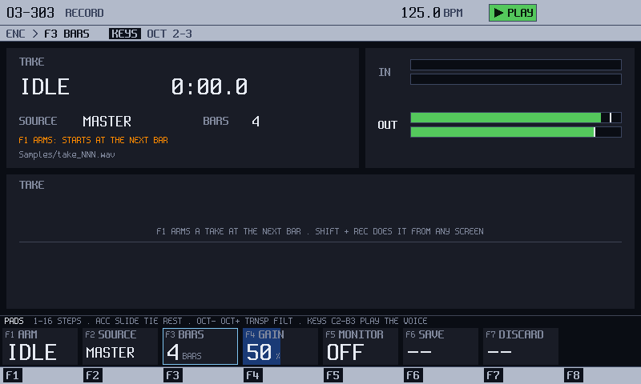

*RECORD, idle. F1 arms a take; it starts at the next bar.*

| Key | What |
|---|---|
| F1 ARM | Arm a take of the master (what o3-303 plays; the inputs are not recorded): it starts at the next bar (a FREE take with the transport stopped starts at once; F1 ends a FREE take) |
| F2 BARS | 1, 2, 4, 8 or FREE |
| F3 SAVE | Write the take to the card as a WAV |
| F4 DISCARD | Drop the take (press twice) |

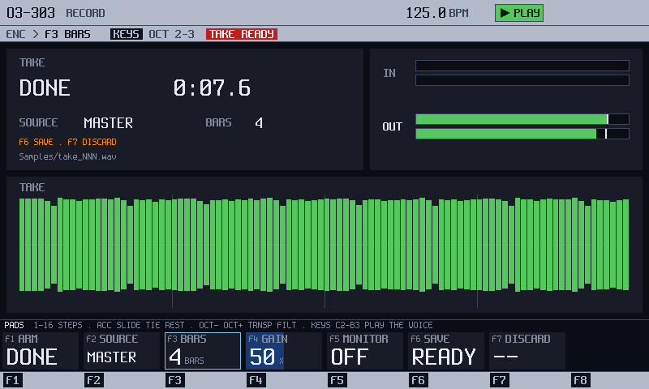

*A four-bar take, done. F3 saves it, F4 drops it.*

---

## 6. The pads

The pads change their job only in ways you can see: another screen, a lit mode pad (TRNSP or FILT), or Pattern held. HELP's PADS page
(Shift + Config, then F2) draws the map of the screen you are on. These are those pages.

### HOME, PATTERN SETUP, INSTRUMENT, MODDED, GROWL, WOBBLE, MASTER and RECORD

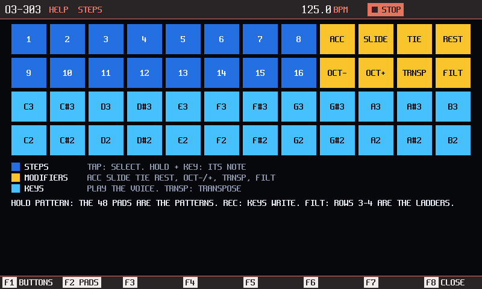

*The home map. With FILT on, rows 3 and 4 are the CUTOFF and RESO ladders instead of the keys.*

```
          col 1   2    3    4    5    6    7    8  |   9      10     11     12
row 1      1    2    3    4    5    6    7    8   |  ACC   SLIDE   TIE    REST
row 2      9   10   11   12   13   14   15   16   |  OCT-  OCT+   TRNSP  FILT
row 3     C3  C#3   D3  D#3   E3   F3  F#3   G3   G#3    A3     A#3    B3
row 4     C2  C#2   D2  D#2   E2   F2  F#2   G2   G#2    A2     A#2    B2
```

OCT- and OCT+ move rows 3 and 4 by octaves; the header's KEYBOARD says which (OCT 2-3 at first).

### PERFORM, PERFORM KNOBS and PERFORM SETUP

On PERFORM KNOBS each row of pads is one knob, as the tables above say; HELP's PADS page lists the four rows.

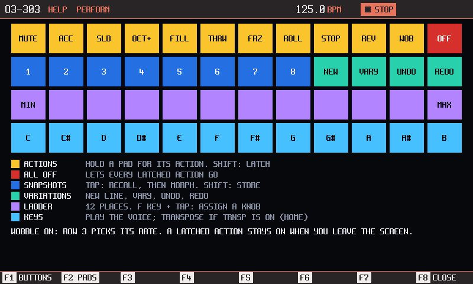

*PERFORM's map. With WOB on, row 3 picks the wobble's rate.*

### SONG

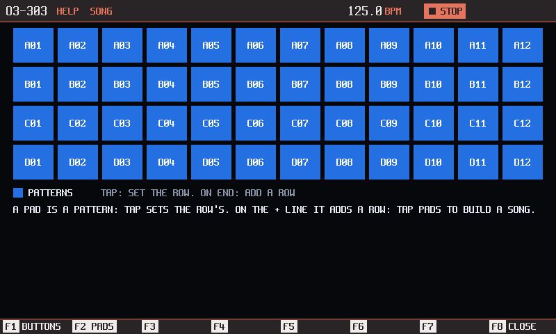

*On SONG, a pad is a pattern: a tap sets the row's pattern, or adds a row on the + line. The same grid is HOME's with Pattern held.*

### FILE LIBRARY

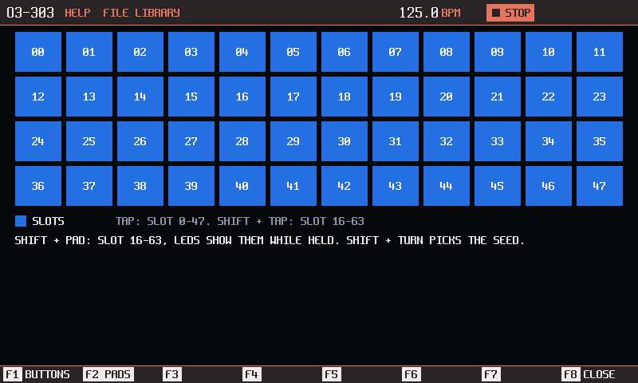

*A pad loads that slot of the bank (0 to 47); Shift + a pad loads slot 16 to 63.*

### The name keyboard

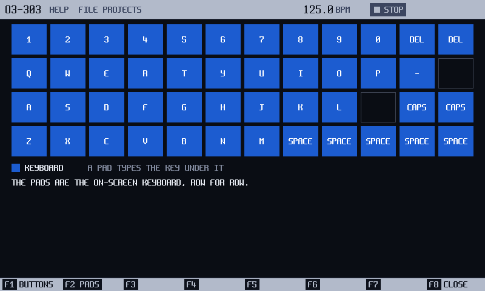

*While you type a name, the pads are the on-screen keyboard. DEL erases, CAPS switches case.*

On FILE PROJECTS the first pads are the list's visible rows, top to bottom.

---

## 7. Experiment without fear

- **UNDO and REDO.** Shift + F8 is UNDO and Shift + F7 is REDO wherever you edit: HOME, PATTERN SETUP, PERFORM and SONG. The history holds the last 32 changes
  to the patterns and the song. Turning the encoder on one step is one change, not forty.
- **The pattern tools** (Shift on HOME): NEW, VARY, RHYTHM, NOTES, REVERSE, CLEAR. Each one is a single undo, so press NEW five times and
  UNDO back to the one you liked. PERFORM's row 2 has NEW, VARY, UNDO and REDO on pads, for doing this live.
- **The library** loads a line into the pattern shown, and UNDO takes the line back. UNDO does not take back the tempo (a load while the
  transport runs keeps it) or the sound a LOAD BOTH or LOAD SOUND sets: the screen starts on LOAD LINE, which leaves the sound alone, and Shift + F3
  brings back the sound a load replaced (section 5, FILE LIBRARY).
- **Snapshots** (PERFORM): store a sound before you twist the knobs, recall it when you get lost, and morph between two.
- **MODS** (Shift + Sample Load, from any screen): turns the MODDED mods off to hear the plain 303, and on again, with your settings
  kept (section 5, MODDED).
- **Copy first.** On PATTERN SETUP, Shift + F3 DUP>NEXT copies the pattern into the next one: change the copy and keep the original.
- **REVERT** (FILE PROJECTS, F5 twice) takes the whole project back to your last Shift + File.

---

## 8. Projects and the card

A project is everything you make: the 48 patterns, the song, the sound, the snapshots, the tempo, PERFORM's settings and the generator's.

### Saving

- **Autosave.** With a card in, o3-303 writes your work to the card about 10 seconds after your last change, and at least once a minute
  while you keep changing things. Config's AUTOSAVE sets it to OFF, 10 S or 30 S. FILE PROJECTS shows "AUTOSAVED 3 S AGO".
- **SAVE** (Shift + File, or F2 on FILE PROJECTS) makes a save point. REVERT goes back to it.
- **When you switch on**, the project you used last comes back, as autosave left it.
- **The first time** on a card with no project, o3-303 starts a project called UNTITLED and autosaves into it. Use SAVE AS to give it a
  name.
- **Without a card** o3-303 still plays: it starts on the factory line and saves nothing.

While the project loads after switching on (a moment, with a card), Play, the pads and the encoder wait: a press in that moment is not
taken. If the load has not settled after three seconds they are yours again, and then, if you play or edit before the project has loaded,
o3-303 keeps what you are doing, does not load, and turns autosave off ("AUTOSAVE OFF: PLAYING BEFORE THE LOAD", or "AUTOSAVE OFF:
EDITED BEFORE THE LOAD" when you edited). LOAD the project from FILE PROJECTS, or SAVE AS to keep what you did.

### On the card

| Where | What |
|---|---|
| `Apps/o3_303/<name>/project.o3a` | The project as your last SAVE left it |
| `Apps/o3_303/<name>/live.o3a` | The project as autosave left it |
| `Apps/o3_303/last.txt` | Which project to open at the next start |
| `Apps/o3_303/system.o3s` | The settings of Config |
| `Samples/take_001.wav`, `take_002.wav`, ... | Your recorded takes |
| `Apps/o3_303/<name>/.deleted` | The marker DELETE leaves: the list hides that folder, and its files stay |
| `<file>.bak` next to a file | The copy before the last save of that file (`project.o3a.bak`, `system.o3s.bak`), kept so a cut save loses nothing |
| `_o3save.tmp` | A save in progress: the file is written here, checked, then renamed. One left behind is from a save that was cut; the next save clears it |

When the unit starts, it opens the newer of `live.o3a` and `project.o3a`.

These are still only the two places o3-303 writes in. DELETE frees no space: to make room on a full card, remove a hidden project's
folder on a computer.

If you take the card out, put another one in, or open it on a computer, autosave turns off until you SAVE or LOAD: a different card could
hold a project with the same name.

### Load, new, revert, delete

All on FILE PROJECTS (see [FILE PROJECTS](#file-projects)): F1 LOAD, F3 SAVE AS, F4 NEW, F5 REVERT, F6 DELETE.

Config's **RESET PROJECT** (F1, then F1 again) starts the project you are in again from the factory line, keeping its name. It stops the
transport and resets everything else too: the sound (the mods, the growl and the wobble included; the voice and distortion go to the library's LAST first, Shift + F3 on FILE LIBRARY brings them back), the snapshots, PERFORM's assignments,
the generator's settings, the tempo (125 BPM) and the song. The PAGE window says PROJECT RESET - LAST: SHIFT F3. UNDO brings back only the patterns and the song; the rest is gone
unless you REVERT to your last save.

---

## 9. Settings

Press **Config**. LEFT and RIGHT change the section, UP and DOWN the row, the encoder or F1 changes a value. An action (like RESET
PROJECT) wants F1, then F1 again. F8 goes back; Config closes the screen.

The first sections are the unit's own (from o3-sdk): FIRMWARE, AUDIO, MIDI, CARD, DISPLAY and INFO, the ones the unit has. Then comes
o3-303's own page, **303**. The settings are kept on the card and come back at the next start.

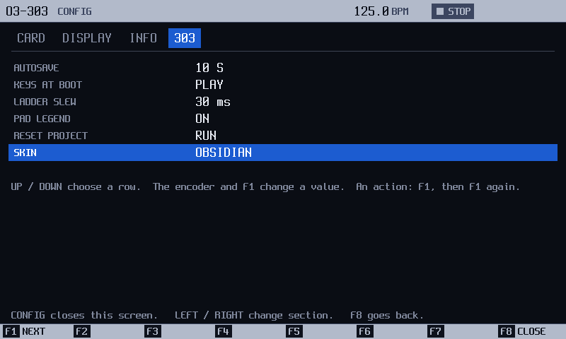

*Page 303, with SKIN set to OBSIDIAN. (The simulator has no firmware, audio or MIDI section, so its tabs start at CARD.)*

| Page 303 | What | Values (the default in bold) |
|---|---|---|
| AUTOSAVE | How soon after a change the project is written | OFF, **10 S**, 30 S |
| KEYS AT BOOT | Whether TRNSP is on when the unit starts | **PLAY**, TRANSPOSE |
| LADDER SLEW | How long a ladder tap glides | 10 to 100 ms (**30 ms**) |
| PAD LEGEND | The PADS line on every screen | OFF, **ON** |
| RESET PROJECT | Start this project again from the factory line (F1 twice): the sound, snapshots, assignments, tempo and song reset too; UNDO brings back only the patterns and the song (section 8) | |
| SKIN | The look (section 13) | CLASSIC, **OBSIDIAN** |

The sound is no longer on this page. The five settings that were on the old page DEEP are on the screens of their sounds, and a project
saves them with its sound:

| Was on DEEP | Now | At first |
|---|---|---|
| FMT MIX | GROWL, F3 FMT MIX | 100 % |
| CMB TUNE | GROWL, F4 CMB TUNE | +7 st |
| CMB FB | GROWL, F5 CMB FB | 0.6 |
| WOB RESET | WOBBLE, F5 RESET | OFF |
| DLY MODE | MASTER, F5 DLY MODE | PING |

A settings file from before that still holds the DEEP values loads with them ignored.

---

## 10. MIDI

> Checked on a unit over USB (2026-11-01): notes play on pitch; FOLLOW CLOCK holds the master's tempo exactly from 60 to 300 BPM, with
> no drift over 10 minutes (the unit's clock 0.3 ms from the master's); CLOCK OUT keeps time to 0.001 %; a learned knob stays learned
> after a restart; 20 minutes of play dropped nothing. The DIN ports have not been checked on a unit yet.

Over USB, a computer sees the unit as a MIDI port, next to its audio and console; nothing needs installing. The DIN ports work the same way:
Config's MIDI section says which one is followed (FOLLOW PORT).

- **Notes play the voice.** Notes that come in over MIDI play o3-303's voice. Config's MIDI section sets the channel (IN CHANNEL, OMNI
  takes them all). A note played at velocity 96 or more is accented, one below 96 is not (the pads and the on-screen keys play at 90, and at 127
  when the step they play is accented); slides come from overlapping notes, as before.
- **MIDI learn.** On INSTRUMENT, MODDED and GROWL, hold Shift: the F keys that say LEARN can follow a controller. Press Shift + the F key,
  then move the controller's knob. Shift + the same key again cancels. The mods and the growl's knobs can be learned; MODS and the
  wobble's settings show "-". Config's MIDI section has CLEAR LEARN (F1 twice) to remove every binding.
- **Clock.** Config's MIDI section has FOLLOW CLOCK and FOLLOW PORT (follow another machine's tempo), TRANSPORT IN, and CLOCK OUT and
  TRANSPORT OUT for the other direction. MASTER's CLOCK line says whether the tempo is INTERNAL.

Known:
- When the master sends Start together with its first clock (most computer sequencers do), o3-303's first beat comes about 25 ms after
  the master's at 128 BPM, and the gap closes within six clocks. Known, not scheduled.
- A long SysEx dump sent to the unit while it plays can cut notes and controllers that arrive at the same time. Send dumps while it is
  stopped.

---

## 11. Recording a take

1. Press **Sample Rec**. RECORD opens.
2. **F2** picks the length: 1, 2, 4 or 8 bars, or FREE. (The take is always the master, what o3-303 plays.)
3. Press **Play**, then **F1 ARM**. TAKE lights in the header; the take starts at the next bar and stops by itself after its bars. (A FREE
   take ends when you press F1.)
4. **F3 SAVE** writes it to the card as `Samples/take_NNN.wav`, a new number each time. **F4** twice drops it.

**Shift + Rec** arms or stops a take from any screen, so you can record while you play on PERFORM. A take armed with Shift + Rec saves
itself to `Samples/take_NNN.wav` when it ends, and Shift + Rec on a finished take saves it too. Only a take armed with F1 waits for
**F3 SAVE**; until you save it, it is lost when the unit restarts, and a new take cannot be armed ("SAVE OR DISCARD THE TAKE (F3 F4)").

A take holds up to 30 seconds. Bars that do not fit at the tempo are refused before the take starts ("8 BARS TOO LONG AT 60.0"; a take
that waits for its bar is disarmed if the tempo slows that far): pick fewer bars or a faster tempo.

---

## 12. HELP on the unit

Press **Shift + Config** on any screen. HELP opens over it and tells you what that screen does: a one-line summary, then two pages.

- **F1 BUTTONS**: every button with what it does here, the Shift meaning in blue, and what each F key is (with its Shift row). Down
  shows more when the list is long.
- **F2 PADS**: the pad map, coloured by group, with a line per group.

**F8** or **Config** closes HELP. Pictures of both pages are in sections 3 and 6.

---

## 13. Two looks: CLASSIC and OBSIDIAN

o3-303 has two looks. **CLASSIC** is the plain one the o3-sdk screens use. **OBSIDIAN** draws a 303-style panel: red digits for the pattern
and tempo, lamps, real-looking knobs, dark glass. The buttons and the pads do the same in both.

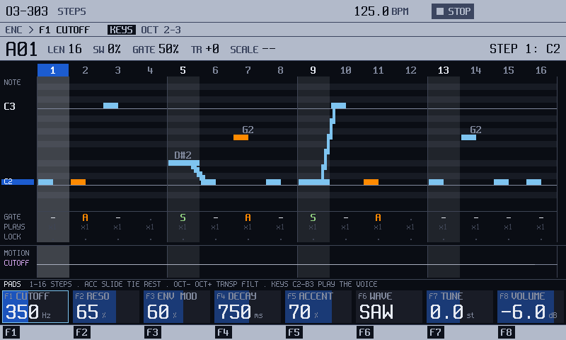

*HOME, CLASSIC.*

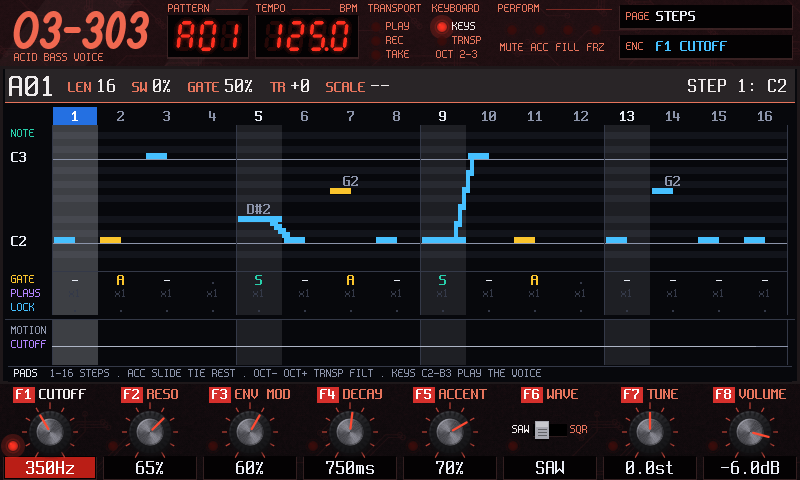

*The same moment, OBSIDIAN.*

- **To switch**: Config, page 303, the SKIN row (the last one), turn the encoder. The choice is kept.
- **OBSIDIAN is the default.** A unit that has already saved its settings keeps the look it had: switch it on the SKIN row.
- **Every screen has its OBSIDIAN form except FILE LIBRARY.** HOME, PATTERN SETUP, PERFORM, PERFORM KNOBS, PERFORM SETUP, INSTRUMENT, MODDED, GROWL,
  WOBBLE, SONG, MASTER, RECORD and FILE PROJECTS (with its name keyboard) have it. FILE LIBRARY keeps its CLASSIC layout, with the header and the key row of the
  system, in the OBSIDIAN colours: it is too full to be redrawn on the panel. The pictures of the screens in this manual show the OBSIDIAN
  look, except where they say CLASSIC. Config is the unit's own screen and looks the same in both; HELP takes the look's colours.

---

## 14. When something goes wrong

**The unit does not start o3-303, or you want the stock firmware back.** See section 2: the way back is the card and the hidden reset
button.

**The messages**, as the PAGE window or FILE says them:

| Message | What it means, what to do |
|---|---|
| NO CARD | No card is in. o3-303 plays, but nothing is saved. Put a card in, then SAVE |
| CARD WRITE PROTECTED | The card is write protected: o3-303 can load from it but not save. Unlock it (the switch on the card or its adapter) |
| CARD NOT SUPPORTED | The card is not FAT formatted (exFAT, for example), so o3-303 cannot save on it. Use a FAT32 card |
| CARD ON COMPUTER | The card is shared with a computer over USB (disk mode). Eject it on the computer first |
| CARD IN USE | A firmware update is using the card. Wait until it ends |
| CARD IS FULL | Make room on the card (on a computer), then SAVE. DELETE frees no space: its files stay on the card (section 8) |
| SAVE FAILED: ... | The save did not reach the card; the reason follows. The status line keeps SAVE FAILED in red until a save works |
| NO AUTOSAVE (a chip in the header) | Autosave is suspended for as long as it shows: no project is on the card (no card at start-up, a card change, or one of the AUTOSAVE OFF messages below). Nothing is kept until you SAVE or LOAD a project. In OBSIDIAN the chip takes the tagline's place while it shows |
| CARD CHANGED: SAVE TO KEEP THE PROJECT | A card went out or in. Autosave is off until you SAVE or LOAD |
| AUTOSAVE OFF: PLAYING BEFORE THE LOAD | You played before the project loaded at start-up (section 8). LOAD it, or SAVE AS |
| AUTOSAVE OFF: EDITED BEFORE THE LOAD | You edited before the project loaded at start-up (section 8). LOAD it, or SAVE AS |
| CARD READ FAILED: AUTOSAVE OFF | At start-up the card could not be read (not a missing file: a read error). The project on the card is left as it is and nothing is saved over it. Check the card, then LOAD the project from FILE PROJECTS; or SAVE, which saves under a new UNTITLED name |
| PROJECT DAMAGED | A project file is broken. o3-303 tries the other copy |
| LOADED THE SAVED COPY | One copy was broken; the other one loaded |
| PART OF THE PROJECT SKIPPED | The project loaded, but some of it could not be read |
| PROJECT FROM A NEWER O3-303 | Made by a newer o3-303. Install that version to open it; nothing is written over it |
| NOTHING SAVED YET | REVERT has no save to go back to |
| LOAD ANOTHER FIRST | DELETE never deletes the project that is open |
| NAME TAKEN | A project of that name is on the card. Pick another |
| NOT A PROJECT NAME | The typed name cannot be a project folder: it must start with a letter or a digit, must not end with a space, cannot hold a dot, and cannot be Samples. Change it on the keyboard, which stays open |
| BUSY | A project job (a load, save, new project, revert or delete, or the load at start-up) is still running. Wait a moment and press the key again |
| PROJECT RESET - LAST: SHIFT F3 | Config's RESET PROJECT has run (section 8). UNDO brings back the patterns and the song; the old sound is in the library's LAST |
| NAME USED BEFORE: PICK ANOTHER | A project of that name was deleted before, and the card keeps the name. Pick another |
| TOO MANY PROJECTS | The list is full. Delete one you do not need |
| 8 LANES USED: CLEAR LOCKS (SETUP) | A pattern holds locks and motion for eight knobs at most. PATTERN SETUP's Shift + F4 clears them |
| BARS TOO LONG AT ... (for example 8 BARS TOO LONG AT 60.0) | On RECORD: that many bars at that tempo run over the 30 seconds a take holds. Pick fewer bars (F2) or a faster tempo |
| MIDI CLOCK LEADS | TAP or NUDGE while the tempo follows a MIDI clock: the tempo is the other machine's (section 10) |

**No sound.** Check F8 VOLUME on HOME, F4 MASTER on MASTER, that MUTE is not latched on PERFORM (ALL OFF lets every action go), and that OVERDRIVE on MODDED TONE (F3) is not OFF, the bottom of its range, where no oscillator reaches the filter. If the
header says STOCK, the mods are off on purpose: Shift + Sample Load turns them back on.

**The keys do nothing, or some are dark.** A scale chosen on PATTERN SETUP keeps the keys to it. TRNSP on (row 2, column 11) makes the keys
transpose while the line plays instead of playing the voice. FILT on (row 2, column 12) turns rows 3 and 4 into the filter ladders.

**The encoder changes the wrong thing.** Look at the ENC window. A colour button may hold a row: tap an F key to give the encoder back to
the knob.

---

## 15. The USB console

For those who connect a computer: o3-303 has o3-sdk's USB console, and adds one command.

| Command | What |
|---|---|
| `skin on`, `skin off` | The OBSIDIAN look on or off at once, the same switch as Config's SKIN row; saved a few seconds later, like a Config change |
| `skin`, `skin stats` | How long the screen takes to draw (for developers); `skin` alone prints the same |
| `skin ballast N` | A test load for the display (for developers) |

How to reach the console, and everything else it does (screenshots, state, input), is in o3-sdk's
[platform/mk66/tools/README.md](https://github.com/trak3r-os/o3-sdk/blob/main/platform/mk66/tools/README.md), section "The USB console
tools".

---

*This manual follows the firmware as it is in this repository. The pictures are made by `tools/manual_images.py` from the scenarios in
`app/scenarios/`: run it again (`python3 -I tools/manual_images.py --sim build-host/app/o3_303_sim`) when a screen changes.*
